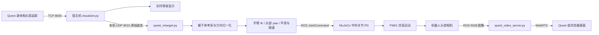

# Quest → PM01 实时遥操作控制工作报告

日期：2026-10-22  
范围：本次实时动作接入、姿态修正、手部高度补偿和运行环境恢复。依据当前源码与本次调试记录编写。

## 1. 本阶段成果与边界

已将 Quest 的连续身体追踪接入 PM01 MuJoCo 模拟器，实现双臂和头部左右转动跟随，并保留原有骨架可视化及机器人头部视频回传。用户已确认能够观察到动作跟随，随后反馈并修正了头部方向错误、姿态扭曲及手部偏低问题。

当前采用“几何动作重定向 + 关节 PD 控制”。没有训练神经网络，也未接入行走策略。机器人底座通过仿真 weld 约束固定，腿部、腰部维持默认关节目标；每侧手臂求解三个肩关节和一个肘屈伸关节。肘部轴向旋转关节未参与重定向，手指和腕部姿态没有跟随。当前头部模型只有 yaw 自由度，因此不复制人的低头、仰头或侧倾。

手部高度补偿属于经验修正，不代表已完成个人体型标定或末端位置精度验证。尚未在实体机器人上验证。

## 2. 系统数据链路



动作控制和视频回传是两个独立方向的通道。看到机器人画面只能证明视频链路工作，不代表机器人已经收到关节指令。

宿主机只由原有 visualizer 监听 TCP 8000，控制器监听另一个本机 UDP 端口，避免两个程序争用 Quest 接收端口。当前 Docker 使用 host 网络，因此宿主机与容器可以通过 127.0.0.1:9010 通信；改成 bridge 网络时需要重新配置地址和端口。

转发发生在 visualizer 的原始字符串解析入口，发送的是原始 Unity 坐标数据，不是经过绘图坐标转换后的数据，避免重复转换。

## 3. 控制相关代码结构

以下路径以 `wholebody_teleop_ws` 为基准；HTS 可视化入口位于相邻的 `hand-tracking-streamer` 工程。

| 文件 / 模块 | 职责 | 设计目的 |
|---|---|---|
| `../hand-tracking-streamer/scripts/visualizer.py`：`StreamReceiver` | 接收 Quest TCP/UDP 数据、显示骨架；按环境变量转发 Body joints_pose 与 Head pose | 复用原有接收流程，保持捕捉与机器人控制同时工作 |
| `scripts/quest_retarget.py`：`parse_pose`、`parse_head` | 识别数据标签，兼容调试元数据，检查长度和有限数值 | 拒绝缺失、格式错误、NaN 等输入 |
| `scripts/quest_retarget.py`：`Retargeter.__init__` | 加载 IK 模型、建立关节索引和 qpos/DOF 映射、设置默认姿态 | 避免把人体骨架编号直接当成机器人关节编号 |
| `scripts/quest_retarget.py`：`Retargeter.solve` | 建立人体参考系、提取肢段方向、补偿、IK、头部映射、平滑与限速 | 核心动作重定向算法 |
| `scripts/quest_retarget.py`：`main` | UDP 接收、最新帧选择、数据超时管理、ROS 发布 | 把几何算法接入持续运行的控制循环 |
| `scripts/prepare_quest_teleop.py` | 生成临时固定底座场景、简化 IK 模型和独立控制配置 | 将遥操作实验配置与普通仿真配置分离 |
| `scripts/run_quest_teleop.sh` | 检查依赖，启动模拟器、控制桥接器和视频服务，管理退出 | 提供统一入口，避免漏启动控制器 |
| `scripts/setup_quest_teleop.sh` | 恢复视频 Python 环境，安装遥操作依赖并检查 ROS 消息导入 | 处理容器重建后的依赖缺失 |
| `src/simulation/mujoco_simulation/src/robot_interface.cpp` | 接收 JointCommand，依据真实仿真关节位置和速度计算 PD 力矩 | 执行底层关节闭环 |
| `scripts/tests/test_quest_retarget.py` | 几何、输入合法性、坐标不变性、限位、补偿测试 | 验证重定向逻辑 |
| `scripts/tests/check_quest_teleop_live.py` | 启动真实模拟器并发送合成姿态，检查关节响应和失流保持 | 验证整条控制链路 |

## 4. 核心设计思路

### 4.1 从人体世界坐标提取躯干相对方向

人的肩宽、上臂和前臂长度，与 PM01 的关节结构并不一致。直接要求机器人的手到达人体世界坐标，会混入人的站立位置、身高和机械臂可达性差异。

当前算法仍读取世界坐标，但只用它构造相对向量。机器人目标不直接采用人体的绝对位置。

使用身体关节索引：髋部 1、胸部 5、头部 7；左臂 10/11/19，右臂 15/16/45，分别表示上臂起点、肘部和腕部。

先定义躯干向上方向 u，再从左右肩方向中剔除与 u 平行的分量，得到向左方向 l。按照当前 Unity 左手坐标约定，向前方向为 f = u × l。

```text
u = normalize(chest - hips)
l_raw = left_shoulder - right_shoulder
l = normalize(l_raw - dot(l_raw, u) * u)
f = cross(u, l)
B = [fᵀ; lᵀ; uᵀ]
```

人体上臂、前臂分别转为单位方向：

```text
d_upper = B * (elbow - shoulder) / ||elbow - shoulder||
d_lower = B * (wrist - elbow) / ||wrist - elbow||
```

此时三个分量分别对应前、左、上。平移被相减消除，臂长被归一化消除，整体朝向由躯干基底消除。机器人实际臂长由自身模型决定。

这一设计实现的是肢段方向近似一致，不保证人的手和机器人手在画面里具有完全相同的高度或位置。测试中的尺度不变性以骨架仍通过最小长度有效性检查为前提。

### 4.2 手臂 IK：匹配方向，而不是固定世界位置

每侧优化以下四个关节：shoulder_pitch、shoulder_roll、shoulder_yaw、elbow_pitch。

通过 MuJoCo 正向运动学计算机器人肩、肘与近似手端位置。当前肩部参考点使用 shoulder_roll_link；手端采用 elbow_yaw_link 的局部偏移 `[0.03, 0, -0.14]` 米。后者是当前模型上的近似选点，尚未用实体末端标定。

机器人肩部多个旋转轴存在空间偏移，肩部参考点本身会随上游关节运动。因此对于两端点 a、b 构成的方向 d，其 Jacobian 使用相对位置导数：

```text
d = (b - a) / ||b - a||
J_direction = (I - d*dᵀ) * (J_b - J_a) / ||b - a||
```

将上臂与前臂的方向误差堆叠，得到六维误差 e 和 6×4 Jacobian J。当前实现每侧最多进行 12 次迭代：

```text
delta_q = solve(JᵀJ + 0.04I,
                Jᵀe + 0.015 * (q_rest - q))
```

阻尼项降低近奇异姿态时的数值不稳定；轻微默认姿态偏好减少直臂时不必要的轴向扭转。求解从上一帧目标姿态开始，保留时间连续性。迭代增量限制为每关节 ±0.10 rad，并执行模型关节限位。该实现没有专门的自碰撞避免优化。

### 4.3 头部：区分相机坐标系与骨骼坐标系

此前代码把 Body_Head 的局部 +Z 当作视线方向。已有录制数据表明，在当前数据源中，该方向接近头部侧向，而骨骼 +Y 对应前向。这样计算出的 yaw 容易出现接近 90° 的偏置，随后被机器人限位截断，表现为头部扭向一侧。

修正后：

- 有 150 ms 内接收的独立 Head pose 时，使用相机四元数旋转局部 +Z。
- 否则使用 Body_Head 四元数旋转局部 +Y。
- 将视线投影到躯干前、左方向，计算 `yaw = atan2(gaze_left, gaze_forward)`。
- 水平投影长度不超过 0.25 时保持 yaw，避免垂直视线附近的方向不确定性。
- 执行头关节限位、平滑和输出限速。

独立 Head pose 与身体姿态目前按照接收新鲜度组合，并没有按设备采样时间做严格同步。头部轴定义适用于当前已检查的数据源；更换 SDK 或数据格式后应重新验证。

### 4.4 手部偏低的临时补偿

用户反馈机器人手端相对偏低后，增加参数 `--hand-height-bias`。默认值 0.15，允许 -0.5 到 0.5。

```text
d_lower_corrected = normalize(d_lower + [0, 0, bias])
```

补偿在人体躯干坐标系中完成，作用于归一化前臂方向。正值主要抬高水平或斜向前臂对应的目标，竖直前臂仍保持竖直方向。0.25 是无量纲方向偏置，不是 25 cm，也不意味着固定抬高某个距离。

这个方法改动小、便于现场调节，但会改变目标肘角。手端偏低的具体贡献尚未完全分离：人体/机器人肢段比例、肩部高度、近似手端位置、IK 折中和 PD 静态误差均可能影响结果，不能仅凭视觉反馈断言全部由尺度问题导致。

### 4.5 平滑、限速与两层控制

重定向层使用 80 ms 时间常数的一阶平滑，更新系数为 `1 - exp(-dt/0.08)`；实现中 dt 限制在 0 到 0.05 s。输出每次关节变化不超过 `1.5 * dt` rad。该限速针对目标位置，不是对实际关节速度的硬约束。

ROS 发布循环目标为 60 Hz，实际频率取决于计算时间；只有收到有效身体帧时才重新求解 IK。程序优先选取本轮收到的最新身体帧，每轮最多读取 256 个 UDP 数据报，避免无限处理接收队列。

下层仿真执行：

```text
tau = tau_feedforward + Kp * (q_target - q_actual)
                      + Kd * (dq_target - dq_actual)
```

当前桥接器发送 dq_target=0、tau_feedforward=0。手臂 Kp/Kd 从 250/1 调为 60/6，头部从 100/1 调为 15/1.5，以降低高刚度、低阻尼产生振荡的风险。没有加入专门的重力补偿，实际姿态仍可能存在负载相关误差。

Python 重定向器不订阅真实关节状态来修正 IK，其内部模型沿上一帧目标推进；实际位置和速度反馈闭环在 C++ PD 层中实现。视频则构成人通过观察进行操作调整的视觉反馈。

超过 300 ms 没有有效身体数据会提示 Tracking stale，并继续发布最后关节目标。该行为是保持目标，不是停止施加力矩，也不保证实际位置完全不变。

### 4.6 固定底座与模型拆分

准备脚本生成临时 scene.xml、ik.xml 和 config.yaml。运行场景保留传感器插件，并增加 base_link 到世界的 weld 约束；IK 模型去掉 sensor 和 extension，避免 Python MuJoCo 因未加载 C++ 自定义传感器插件而失败。网格和资源目录转换成绝对路径，保证临时目录中的模型仍可加载。

指令与状态分别使用 `/simulation/quest/joint_command` 和 `/simulation/quest/joint_state`，避免复用 `/hardware/joint_command`。普通仿真源配置保持原样。

## 5. 遇到的问题、原因与处理

| 问题 | 原因 / 证据 | 处理和状态 |
|---|---|---|
| 有机器人画面但不跟随 | 使用 run_quest_sim_video.sh；该入口只启动仿真和视频服务 | 改用 run_quest_teleop.sh，同时启动带转发环境变量的 visualizer；已验证 |
| 机器人姿态扭曲 | 初版位置目标忽略机器人肩关节偏移，人体与机器人比例也不同 | 改为躯干相对肢段方向 IK，使用移动肩点的相对 Jacobian 和近似手端；已验证算法及合成动作，真人精度仍需评估 |
| 头部明显扭向侧面 | 把骨骼 +Z 误作视线轴；已有录制数据支持轴定义不一致 | 区分相机 +Z 与骨骼 +Y，增加垂直视线保持；合成仿真验证通过 |
| 抖动 / 振荡风险 | 旧 PD 增益高刚度、低阻尼；输入噪声和 IK 多解也可能贡献 | 降低刚度、增加阻尼、目标滤波与限速；不能把所有视觉扭曲都归因于 PD |
| 机器人手偏低 | 精确原因尚未完成标定，比例、末端选点、IK/PD 误差均可能参与 | 增加躯干空间 hand-height-bias；双手抬高测试通过，属于临时补偿 |
| Python 路径不存在 | /home/devel/quest-video-venv/bin/python 确实缺失；容器重建可能清除容器内环境 | 新增完整依赖恢复脚本；并非从现有信息证明一定发生了重建 |
| No module named mujoco | 视频依赖安装不包括遥操作所需 MuJoCo Python 包 | 执行 setup_quest_teleop.sh，已安装 mujoco 3.3.7 并成功检查 ROS/WebRTC 等导入 |
| plugin mujoco.sensor.skin not found | Python IK 加载了依赖自定义插件的完整仿真模型 | 单独生成去掉传感器扩展的 IK 模型，运行仿真仍使用完整模型 |
| 退出时脚本长时间不结束 | 集成测试中视频服务退出等待导致父脚本 wait 超时 | 子进程清理增加约 3 秒等待上限，再结束仍存活的本次子进程；重复集成测试正常退出 |
| ROS 重复 shutdown 报错 | 信号处理可能已关闭 ROS context，finally 再调用 shutdown | 使用 try_shutdown，避免重复关闭异常 |
| adb reverse 提示 USB 权限不足 | 宿主机已在 plugdev 组；Quest 3 被识别为 2833:5013，但 adb 显示 no permissions | 尚未完成修复：需管理员配置匹配设备的 udev 规则或安装发行版 Android udev 规则包，reload/trigger 后重插并检查授权。本次 sudo 需要密码，未修改系统规则 |
| OpenGL 0x501 警告 | 运行环境曾出现该告警，但仍完成仿真关节测试及此前视频出图 | 未定位图形驱动根因，不能记为已修复 |

## 6. 验证记录及其适用范围

本次会话在加入高度补偿后运行 7 项单元测试，全部通过：非法数据拒绝、手臂动作与限位限速、骨骼/相机头部方向、垂直视线保持、整体 yaw/尺度/平移不变性、调试头解析、双手高度补偿。测试函数部分覆盖多个情形。

实际 MuJoCo 集成测试在高度补偿加入前完成：合成抬臂后左臂四关节变化向量的范数约 1.42 rad；给定头部 yaw=0.4 rad，实测约 0.400008 rad，稳态采样摆幅约 4.4×10⁻⁶ rad；断流后的目标保持检查通过。该数据来自固定底座、合成姿态测试，不是 Quest 真人追踪精度或端到端延迟指标。

高度补偿验证比较了两侧机器人模型的手端 FK 高度，尚未重新报告带补偿的完整真人动态精度。最新依赖恢复已输出 `Quest teleop dependencies ready.`，说明导入检查成功，不等同于恢复后已完成所有图形与 USB 联调。

## 7. 当前运行步骤

### 容器：依赖缺失时恢复一次

```bash
cd /workspaces/Learning_Based_Control/wholebody_teleop_ws
bash scripts/setup_quest_teleop.sh
```

### 宿主机：HTS 环境运行接收与转发

在 hand-tracking-streamer 工程目录运行：

```bash
HTS_SIM_FORWARD_PORT=9010 python scripts/visualizer.py \
  --protocol tcp --host 0.0.0.0 --port 8000 --show-fingers
```

USB TCP 模式还需要宿主机成功执行 `adb reverse tcp:8000 tcp:8000`；必须先解决 USB 权限问题。网络 TCP 模式则使用可达的宿主机 IP。

### 容器：启动跟随与视频

```bash
bash scripts/run_quest_teleop.sh --hand-height-bias 0.25
```

不要同时启动占用相同视频端口的旧视频入口。使用 0 可关闭高度补偿，省略参数默认为 0.15。看到 `Tracking active: arms and head following` 表示控制器已收到有效身体姿态；等待提示则应检查 Quest Streaming、转发环境变量和完整身体数据。

### 验证命令

```bash
source /opt/ros/humble/setup.bash
source install/setup.bash
/home/devel/quest-video-venv/bin/python -m unittest discover \
  -s scripts/tests -p test_quest_retarget.py
```

有可用图形显示且没有其他仿真/视频进程占用端口时，可运行 `scripts/tests/check_quest_teleop_live.py`；该脚本会启动仿真、发送合成动作并自动退出。

## 8. 后续改进建议

优先做一次站姿与机器人末端标定：记录自然垂臂、平举、前伸、屈肘等姿态，分别测量方向误差和肩部相对手端误差。把近似手端偏移替换为模型中明确命名的 site，并评估真实关节状态与 IK 目标之间的误差，区分几何问题和控制跟踪问题。

随后可将手端目标表示为“人体肩部相对位移 / 人体总臂长”，再映射到机器人可达空间，联合肘部方向进行优化。这样可以在肢段方向与末端位置之间设置明确权重，而不是持续增加经验高度偏置。

还需补充设备时间戳同步、真人延迟及抖动统计、跟踪恢复测试和自碰撞约束。若扩展到站立、行走或实体机器人，应另外设计浮动基座平衡、接触和力矩约束控制，当前固定底座方案不能直接替代该部分。

## 9. 逐文件代码设计详解

本章按“采集 → 接收转发 → 配置生成 → 重定向 → 动力学执行 → 视频反馈 → 启动与验证”的顺序阅读。这里解释当前实现，不把计划中的标定、平衡控制或碰撞优化描述为已有功能。Unity 数据源和 C++ 仿真接口包含原有工程代码；新增控制逻辑主要集中于 Python 桥接器和配套脚本。

### 9.1 `BodyLandmarkStreamer.cs`：身体姿态的数据生产者

位置：HTS 内层 Unity 工程的 `Assets/Scripts/BodyLandmarkStreamer.cs`。

**数据结构。** `_upperBodyJoints` 显式列出 70 个关节。发送顺序由这个数组决定，而不是由网络接收顺序或机器人关节顺序决定。Python 中的 10、11、19 等索引必须与该数组一致。每个 pose 的布局是 `[x,y,z,qx,qy,qz,qw]`，所以完整一帧包含 490 个数。

**`ProcessBodyData()` 的执行顺序：**

1. 调用 `RefreshBodyData()` 请求更新身体数据。
2. 检查 `_body.IsTrackedDataValid` 与 `SkeletonMapping`。身体数据或映射不可用时直接返回，不把无效数据作为正常帧发送。
3. 根据 `ShowDebugInfo` 决定是否添加帧号和单调时钟时间戳。
4. 获取 root pose，写入单独的 `Body root` 行。
5. 遍历 `_upperBodyJoints`，调用 `GetJointPose`，对有效关节应用 `ApplyLocomotion`，然后写入位置与四元数。
6. 某个关节缺失时写入占位 pose `[0,0,0,0,0,0,1]`，保持后续关节索引不移位。
7. 更新诊断信息并调用 `SendData()`。

**为什么保留占位而不删掉关节？** 如果缺少一个肘部就从数组里删掉它，之后所有索引都会改变，接收端可能把手指数据误认成腕部。固定长度协议解决了索引稳定性，但不等于每个关节都有效。目前没有把逐关节有效位一起发送；控制器只能通过有限值和几何退化检查拒绝部分坏帧，不能识别所有错误占位组合。

**`AppendPose()`、`AppendVector3()`、`AppendQuaternion()`。** 这些函数集中管理文本格式；位置使用四位小数，旋转使用三位小数。集中序列化便于检查协议，但数值量化也是微小抖动的潜在来源之一。

**`InitializeNetwork()` / `SendData()` / `Disconnect()`。** TCP 模式开启 `NoDelay`，发送时附加换行；UDP 按数据报发送。TCP 的换行是接收端恢复消息边界的依据。连接失败走现有 AppManager 的连接管理逻辑。

**与当前控制器的接口边界。** 当前控制器要求开启旋转输出，即 `Body joints_pose`；只有 `Body joints` 的纯位置格式不会被 `parse_pose()` 接收。虽然腕部和控制器也有独立数据流，本版双臂 IK 使用身体骨架中的腕部索引，没有融合独立手腕/控制器位姿。

### 9.2 `HeadPoseStreamer.cs`：独立头显姿态来源

位置：HTS 内层 Unity 工程的 `Assets/Scripts/HeadPoseStreamer.cs`。

**`Update()`。** 检查是否正在 Streaming、是否启用 TrackHeadPose；满足条件后初始化连接，按 `frequencySeconds` 累积计时。默认间隔约 1/30 s，但实际发送时刻受 Unity 更新循环影响。

**`ResolveHeadSource()`。** 优先使用配置的 `centerEyeAnchor`；未配置时尝试 `Camera.main.transform`。这个 Transform 的局部 +Z 是相机前向，与 Body_Head 的骨骼局部轴不同。

**`BuildAndSendPacket()`。** 对头部 pose 应用与身体流相同的 locomotion 处理，再构造 `Head pose` 或带调试元数据的同类标签。输出同样是七个数，四元数顺序是 xyzw。

**设计意义。** 身体头关节和头显相机都描述头部，但其坐标基底不能混用。独立头显 pose 让控制器可以直接取相机视线；身体头关节则作为缺少新鲜相机数据时的后备。此优先级在 Python 控制器中实现，Unity 不负责机器人头关节求解。

### 9.3 `visualizer.py`：一个接收入口，两个消费者

核心类是 `StreamReceiver`。原有绘图逻辑消费本地状态；新增的机器人控制消费转发出去的原始文本。

**`__init__()` 中的新增状态：**

```python
forward_port = os.environ.get("HTS_SIM_FORWARD_PORT")
self._forward_target = ("127.0.0.1", int(forward_port)) if forward_port else None
self._forward_socket = socket.socket(socket.AF_INET, socket.SOCK_DGRAM) if forward_port else None
```

未设置环境变量时不创建转发 socket，仍可单独使用骨架可视化。设置后采用非阻塞 UDP，降低控制器停止或收包变慢对捕捉线程的影响。这里不建立可靠重传队列，因为遥操作更关心当前动作，而不是补执行旧动作。

**`_run_tcp()`。** 建立 TCP server，每个新连接启动一个 `_handle_tcp_conn()` 线程。Quest 身体、手部和头部组件可以分别建立连接，多线程接收能处理这些独立连接。

**`_handle_tcp_conn()`。** `recv(4096)` 得到的是字节流片段，可能只有半行，也可能包含多行。函数把片段追加到 `buffer`，仅在遇到 `\n` 后取出完整行交给 `_handle_line()`。不能把一次 recv 当成一个身体帧。

**`_run_udp()`。** 收到数据报后解码，再逐行调用相同的 `_handle_line()`，让 TCP 与 UDP 共用后续解析入口。

**`_handle_line()` 是本次集成的关键位置：**

```python
label = line.split(":", 1)[0].split("|", 1)[0].strip().lower()
# 实际代码把上述标签提取写在条件表达式中。
if label in ("body joints_pose", "head pose"):
    # 若启用了转发，发送原始文本到本机控制端口。
    ...
parsed = _parse_line(line)
# 后续仍更新原来的手、控制器、身体显示状态。
```

取 `|` 前的标签是为了兼容 `Body joints_pose | f = ... | t = ...:`。转发在绘图坐标转换之前，因此不会先在 visualizer 里变换一次，再在控制器里重复变换。

发送异常被捕获后继续绘图，这是有意选择的故障隔离；代价是当前没有转发失败计数或明显的 UI 提示。出现“骨架正常但机器人不动”时，需继续检查控制器日志，不能仅凭绘图窗口判断转发成功。

**`start()` / `stop()`。** 使用后台接收线程和停止事件，停止时等待主接收线程及连接线程退出。当前新增的转发 socket 没有在 `stop()` 中单独关闭，进程退出时会被回收；如果未来在同一进程里反复创建和销毁 receiver，宜补充显式资源释放。

### 9.4 `prepare_quest_teleop.py`：为本次运行生成三份配置

该文件是一次性准备脚本，主体是从上到下执行的顶层代码。输入参数 `sys.argv[1]` 是输出目录，由启动脚本通过 `mktemp -d` 创建。

**第一步：定位模型。** 从自身路径定位 workspace，读取 `pm01.yaml`，并按配置文件所在目录解析相对 scene 路径。这样不依赖用户当前 shell 所在目录。

**第二步：处理 XML include。** 把当前场景顶层的 include 文件内容加入场景树，并把 compiler 中的 meshdir、assetdir 改为绝对路径。这样将 scene 写到临时目录后，资源查找仍然正确。当前只处理该场景所用的一层顶层 include，不是一个通用的递归 XML 展开器。

**第三步：生成运行场景。** 增加 `equality/weld`，把 `base_link` 固定到世界。固定底座让本阶段只验证上半身映射，不要求控制器同时解决站立平衡。

**第四步：生成 IK 场景。** 对运行场景做深拷贝，删除顶层 `sensor` 与 `extension`，写入 `ik.xml`。模型的关节、几何和惯性仍在；删除的是 Python FK/IK 不需要、且依赖外部动态插件的传感器配置。

**第五步：生成 ROS 与增益配置。** 按关节名称修改肩/肘和头部的 stiffness/damping，替换 command_topic、state_topic，并记录 `scene` 与 `ik_scene` 的绝对路径，写成 `config.yaml`。

三个输出的用途不同：`scene.xml` 给 C++ 动力学模拟器；`ik.xml` 给 Python 运动学求解器；`config.yaml` 同时提供一致的关节顺序、模型路径和通信话题。

### 9.5 `quest_retarget.py`：输入解析与模型初始化

此文件将 ROS 导入放在 `main()` 内，使 `Retargeter` 和解析函数能够在没有启动 ROS 的情况下被测试。它仍依赖 NumPy、MuJoCo 和 YAML；并非完全无外部依赖的纯数学模块。

**`parse_pose(line)`：**

1. 用第一个冒号分开标签与数值。
2. 去掉标签中的调试元数据，精确识别 `body joints_pose`。
3. 把逗号分隔字段转换为浮点数组，格式错误返回 None。
4. 要求恰好 490 个有限数值，再 reshape 成 `(70,7)`。

严格长度检查避免静默截断和关节错位。旧录制文件中存在 84 关节格式；如需离线分析，必须先确认关节顺序并显式选择对应的 70 个关节。实时解析器不会自动猜测不同协议。

**`parse_head(line)`。** 同样兼容调试标签，要求七个有限数值，并检查四元数范数大于 0.1；这里不直接归一化，实际旋转计算时再做归一化。

**`Retargeter.__init__(config, hand_height_bias=.15)`：**

| 成员 | 含义 | 为什么需要 |
|---|---|---|
| `self.joints` | YAML 中 joints 配置 | ROS 数组顺序、默认位置和控制增益的共同来源 |
| `self.model` | MuJoCo 的静态模型 MjModel | 保存运动链、关节限位、索引等 |
| `self.data` | 独立运动学状态 MjData | 保存求解时 qpos、xpos、xmat 等，不等于实际仿真状态 |
| `self.ids` | 按配置关节名称查出的 MuJoCo joint ID | 将配置顺序映射到模型内部顺序 |
| `self.qadr` | 各关节在 qpos 中的位置地址 | 自由基座等会使 qpos 索引不等于 joint ID |
| `self.dadr` | 各关节在速度/切空间中的 DOF 地址 | Jacobian 的列按 nv/DOF 排列，而不是按 qpos 排列 |
| `self.q` | 当前完整机器人目标关节数组 | 持续输出，包括未参与重定向的腿和腰 |
| `self.rest` | 默认目标姿态副本 | IK 轻微回正约束的参考 |
| `self.arms` | 每侧人体索引、机器人控制索引和 body ID | 将左右臂共用一套求解循环 |
| `self.filtered_directions` | 上一次平滑后的四个肢段方向 | 时间滤波的状态 |
| `self.filtered_head` | 平滑后的头部 yaw | 抑制头部目标快速跳变 |

`self.arms` 中仍保存了初始化时计算的 upper_len、lower_len，这是早期位置目标实现留下的数据。目前方向 IK 不用这两个长度来缩放目标；实际段长从每次 FK 的端点差重新计算。阅读代码时不能据此误认为现在仍用“人体长度乘固定比例”的位置映射。

### 9.6 `Retargeter.solve()`：一帧控制目标的完整计算

签名：`solve(poses, dt, head_pose=None)`。输入是身体姿态、距上次成功求解的时间间隔，以及可选的独立头显 pose；返回按配置顺序排列的目标关节数组副本。

**A. 输入和躯干基底检查。** 先验证 `(70,7)` 与有限值，再构造向上、向左、向前基底。胸髋向量和肩间向量过短时抛出 ValueError。计算左方向时先剔除向上分量，是一次正交化，避免倾斜肩线直接污染参考系。

**B. 一次性验证双臂。** 遍历左右臂，计算上臂和前臂方向。任一段长度小于 0.05 m 时拒绝该帧。两臂方向都完成后才开始更新滤波状态和目标关节，避免左臂已修改、右臂数据才被发现退化的部分更新。

**C. 高度补偿。** 对躯干坐标下的前臂单位方向执行：

```python
lower_direction[2] += self.hand_height_bias
lower_direction /= np.linalg.norm(lower_direction)
```

例如水平前伸方向 `[1,0,0]` 加 0.25 后，归一化约为 `[0.970,0,0.243]`，对应约 14° 的向上倾角；这不是让关节固定增加 14°，最终角度还要由整条运动链 IK 求解。垂直向下 `[0,0,-1]` 加 0.25 后仍归一化为垂直向下，因此该方法不会把所有姿态都平移相同高度。

**D. 输入方向滤波。** 使用 `alpha = 1-exp(-clamp(dt,0,.05)/.08)`。第一次收到方向直接初始化缓存，后续做一阶插值。插值后的方向不一定是单位向量，所以使用它计算 IK 误差前会再次归一化。

**E. 提取机器人端点。** 每次 IK 迭代先调用 `mj_forward()`，取得肩 roll body、肘 pitch body 和 elbow yaw body 的位置。近似手端还需要 `xmat @ local_offset`：local_offset 在末端局部坐标里，必须随该 body 旋转，不能直接加在世界坐标上。

**F. 计算点 Jacobian。** `mj_jac()` 为三个点分别生成 3×nv 平移 Jacobian；再用 `self.dadr[indices]` 只选本侧四个受控关节的列，得到 3×4 矩阵。左臂迭代不会直接修改右臂关节。

**G. 将点 Jacobian 转为方向 Jacobian。** 对肩到肘、肘到手两段，计算端点差的 Jacobian，再乘单位化导数 `(I-ddᵀ)/length`。`I-ddᵀ` 去掉沿肢段自身方向的分量，因为只改变长度而不改变朝向的位移不应被视为方向改进。

**H. 求解四维关节增量。** 将两段误差拼接为六维向量，将两个方向 Jacobian 纵向堆叠为 6×4。使用 `np.linalg.solve()` 解 4×4 线性系统，而不是显式求逆。`0.04I` 增强数值稳定性，`0.015*(rest-q)` 提供轻微姿态偏好。两个常数是当前经验调参；它们不是同一个正则化参数的两处严格展开，因此应按实际阻尼更新式理解，不宜宣称代码精确求解了某个统一权重的完整非线性最优问题。

每次迭代增量限为 ±0.10 rad，更新后按 joint range 裁剪，并把结果写回内部 qpos。固定做 12 次迭代，没有误差达到阈值就提前结束的逻辑，也没有输出求解收敛状态。

**I. 计算头部。** 身体骨骼取第 7 个关节的四元数；若传入 head_pose 则取独立相机四元数。对四元数归一化后，骨骼分支计算旋转矩阵第二列（局部 +Y），相机分支计算第三列（局部 +Z）。取躯干平面投影计算 yaw，并做限位和平滑。头部目标只在有效身体帧触发的 solve 中更新；只有 Head pose 到达而身体停止时，不会单独持续转头。

**J. 最终输出约束。** 所有关节做限位，再相对进入 solve 前保存的 `previous` 限制本帧目标变化。IK 内部的 ±0.10 限制和这里的 1.5 rad/s 限制用途不同：前者控制优化步长，后者控制真正发出的目标轨迹。最后用限速后的 self.q 更新内部 FK，供下一帧继续求解，并返回 copy，避免调用者误修改内部状态。

**这里没有做的事情。** 没有用真实 joint_state 修正 Python 的 q，没有完整末端旋转目标，没有平衡控制、重力补偿或自碰撞优化。模型中的肘 yaw 关节仍保持默认值。若前伸动作仍有位置误差，应先区分方向目标折中、末端几何选点与实际 PD 跟踪误差。

### 9.7 `quest_retarget.py/main()`：持续运行与 ROS 消息设计

**启动阶段。** argparse 获取配置、UDP 端口和高度偏置；偏置必须有限且位于允许区间。创建 ROS 节点、Retargeter，并检查指令话题必须以 `/simulation/` 开头。这个检查约束本脚本的目标话题，不等价于整个 ROS 系统的硬件隔离保证。

**QoS。** 发布器使用 depth=1、BEST_EFFORT，与模拟器命令订阅器对应。目的是优先保留最新指令，允许丢失中间更新；不是为每个动作提供可靠排队执行。

**接收阶段。** UDP socket 绑定 127.0.0.1，只接受本机接口流量。每轮最多取 256 个报文，遇到 BlockingIOError 表示当前没有更多数据，退出读取循环。身体数据只保留本轮最后一个有效 pose；相机头部则独立保存最近 pose 与接收时间。这里没有依据设备帧号做乱序拒绝，所以“最新”指当前处理顺序下最新有效输入。

**求解阶段。** 仅在存在最新身体帧时调用 solve，dt 从上次成功求解时刻计算。头部接收年龄小于 0.15 s 时使用相机数据；否则回退身体头关节。ValueError 表示几何输入被拒绝，不更新最后有效时间。当前以 DEBUG 级别记录拒绝原因，正常日志中不一定可见。

**超时阶段。** 300 ms 无有效身体帧后仅改变 stale 标记并告警。没有把目标清零，也没有重新求解旧数据，因此继续维持最后 self.q。首次收到有效输入前则持续发布默认姿态。

**消息字段。** 每轮构造完整 `JointCommand`：

| 字段 | 当前填充值 | 含义 |
|---|---|---|
| header.stamp | ROS 当前时间 | 指令发布时刻；不是 Quest 原始采样时刻 |
| position | solver.q | 全部配置关节的目标角度 |
| velocity | 全零 | PD 目标速度，当前没有目标轨迹导数前馈 |
| feed_forward_torque | 全零 | 未增加重力或其他力矩前馈 |
| torque | 全零 | 消息字段存在；当前 C++ PD 公式使用 feed_forward_torque |
| stiffness / damping | 生成配置中的数组 | 各关节 Kp、Kd |

循环末尾使用 `spin_once(timeout_sec=0)` 处理 ROS 事件，再根据本轮耗时补足约 1/60 s。若计算本身超过 16.7 ms，不额外睡眠，也不会追赶补发多个旧周期。退出时关闭 socket、销毁节点并 try_shutdown。

### 9.8 `robot_interface.cpp`：关节索引、线程同步与实际 PD

**`initialize()`。** 根据配置创建状态发布器，注册关节和传感器，创建 JointCommand 订阅器。订阅器使用 KeepLast(1)、best_effort。随后设置默认命令数组，保证存在初始命令结构。

**`registerJoints()`。** 遍历模型 actuator，依据 actuator 关联的 joint name 在配置关节列表中查找对应项。分别保存 qpos 地址、qvel 地址和 ctrl 地址。三类地址分开管理，因为模型的状态存储和执行器存储不一定具有相同顺序。配置列表的顺序也就是 ROS 数组的顺序。

**`jointCommandCallback()` 与 `command()`。** 回调接收到消息后用 mutex 保护最新命令；物理线程通过 command() 获取受锁保护的副本，避免读到另一个线程正在修改的数组。当前回调直接保存消息，没有验证数组长度、有限值或做独立超时处理，因此完整合法的数组目前由 Python 桥接器负责提供。

**`torqueControl()`。** 从实际 mjData 读取关节位置和速度，与目标计算误差，写入对应 actuator 的 ctrl。这里形成实际关节闭环。Python 的 self.data 仅用于目标计算，不能替代这份动力学状态。

**`update()`。** 从真实 qpos、qvel 和 actuator_force 组装 JointState，再发布传感器数据。集成测试订阅的就是这条实际状态通道，所以“实际手臂动了”的证据不是只看 Python 输出角度发生变化。

### 9.9 `quest_video_server.py`：与控制并行的视觉反馈

该文件没有发布机器人关节指令。它的设计独立于 IK，因此图像正常时仍可能没有动作控制。

**`image_array(msg)`。** 根据 rgb8/bgr8/rgba8/bgra8 判断通道数，检查图像尺寸、step 和数据长度；按行步长去掉 padding，必要时交换 BGR 到 RGB，返回连续内存数组。不能简单把 ROS data reshape 为高×宽×3，因为消息可能有行填充或四通道。

**`ImageSource`。** ROS Image 回调将新图像、接收时间和 sequence 存入共享状态，用 lock 保护。只存最新帧，不建立无限增长的视频队列。`snapshot()` 供异步发送端取得一致的状态快照。

**`RosVideoTrack.recv()`。** 按目标帧率限制发送，等待新 sequence 且图像年龄小于 2 s；将数组转换为 VideoFrame，并构造单调递增的 90 kHz 时间戳。没有新图像时等待，不通过重复旧画面伪造新帧率。frames 与 drops 用于状态统计。

**`VideoServer.websocket()`。** 管理每个会话的 WebSocket、PeerConnection、视频轨和源监控任务。处理 hello、offer、ICE、ping 和 stop_video；校验 session_id，缓存提前到达的 ICE。收到 offer 后建立视频轨并返回 answer。finally 中取消监控、关闭 peer 和轨道。

**`health()` / `preview()`。** 分别提供源图像新鲜度检查和浏览器预览入口。health 中 source_ready 只说明近期收到相机图像，不说明机器人已收到人体动作。

**`main()`。** ROS executor 在后台线程运行，aiohttp 在异步事件循环中处理 WebRTC 与 HTTP，通过 ImageSource 的锁共享最新图像。可选 telemetry-port 是丢弃数据的测试接收端，不是控制器；默认不开启，避免抢占现有动作接收端口。

### 9.10 `run_quest_teleop.sh`：进程编排与故障处理

**环境设置。** `set -eo pipefail` 让关键命令失败尽早退出。根据脚本所在路径定位 workspace，source ROS 与工作区环境；默认 ROS_DOMAIN_ID=87，可沿用调用环境已有值，ROS_LOCALHOST_ONLY 固定为 1。

**解释器与依赖。** 从 QUEST_VIDEO_PYTHON 读取可选自定义解释器，否则使用 `/home/devel/quest-video-venv/bin/python`。启动前执行 import 检查，失败时明确打印 setup_quest_teleop.sh 恢复命令并退出。

**临时目录。** `mktemp -d` 创建本次独立配置目录。避免多个启动共享并覆盖临时 scene，也方便退出后清理。

**子进程启动。** 依次准备配置，再后台运行 C++ 模拟器、Python retargeter 和视频服务，把 PID 保存到数组。`"$@"` 原样转交给 retargeter，所以 `--hand-height-bias 0.25` 和 `--port` 属于动作控制器参数，不会传给视频服务。

**生命周期。** `wait -n` 等待任意子进程结束；启动脚本退出后触发 cleanup，向本次保存的子进程发送 TERM，最多轮询约 3 s，再 KILL 仍未退出的进程并 wait 回收。最后删除临时目录。INT/TERM 转为退出，使交互式 Ctrl+C 也走同一清理路径。该脚本不做自动重启、端口预检或图形授权配置。

### 9.11 依赖恢复文件：为什么视频装好了仍然缺 MuJoCo

**`requirements-quest-video.txt`。** 定义 aiortc、aiohttp 和 NumPy 的版本范围；只负责视频服务依赖。

**`requirements-quest-teleop.txt`。** 用 `-r requirements-quest-video.txt` 复用视频依赖，再加入固定版本 `mujoco==3.3.7` 和 PyYAML。避免维护两份不同的视频依赖列表。

**`setup_quest_video.sh`。** 检查系统是否安装 python3.10-venv，必要时通过 apt 安装；创建带 `--system-site-packages` 的虚拟环境，再 pip 安装视频依赖。允许访问系统包是为了让虚拟环境使用 ROS Humble 的 rclpy。

**`setup_quest_teleop.sh`。** 先运行视频恢复脚本，再安装完整 teleop requirements，source ROS 和 workspace，最终同时检查 mujoco、视频库、rclpy 和 JointCommand 导入。因此它覆盖“解释器不存在”和“视频环境存在但没有 mujoco”两种情况。

恢复脚本目前固定恢复默认路径，不跟随 QUEST_VIDEO_PYTHON 自动创建任意自定义环境；自定义解释器需要用户在对应环境单独安装依赖。脚本也不重新编译 C++ 工作区，如果 install/setup.bash 或自定义消息包不存在，还需执行工程构建流程。

### 9.12 `test_quest_retarget.py`：每项测试究竟验证什么

`sample()` 构造固定的 70×7 合成骨架，其头部四元数使用当前 Meta 骨骼中立轴约定，而不是相机单位四元数。`yaw_quat()` 用 xyzw 顺序组合全局 yaw，支持批量四元数。setUpClass 通过真实准备脚本生成临时模型和配置，tearDownClass 删除目录。

| 测试函数 | 输入变化 | 核心断言 |
|---|---|---|
| test_parser_rejects_corruption | 短帧、NaN、完整帧 | 拒绝损坏数据，合法帧保持布局 |
| test_arm_motion_limits_and_head_sign | 左臂前伸，独立相机左转 | 左臂变化、右臂基本保持；头部符号正确；限位和每步速度限制有效 |
| test_bone_head_neutral_turn_and_vertical_gaze | 骨骼中立、左转、相机垂直向上 | 中立 yaw 为零，转头约 0.4 rad，垂直视线保持已有 yaw |
| test_scale_translation_and_global_yaw_invariance | 骨架整体缩放 1.7 倍、旋转 1.1 rad 并平移 | 两套求解器输出一致，弯肘方向正确 |
| test_debug_headers_and_head_parser | 带帧号/时间戳标签及零四元数 | 正确剥离元数据，拒绝无效头部姿态 |
| test_height_bias_raises_both_robot_hands | 同一姿态分别使用 bias=0 和 0.15 | 双侧 FK 手端升高在 1.5–7 cm 范围，头部目标不受影响；该范围只适用于此测试姿态 |
| test_invalid_tracking_does_not_modify_target | 全零身体点 | 抛出 ValueError，已有目标不被改写 |

这些测试针对已知缺陷和关键不变性，不覆盖所有人体姿态、遮挡、碰撞、长时间运行或网络异常组合。通过某个合成姿态的抬高断言不能推出任意姿态都会抬高相同距离。

### 9.13 `check_quest_teleop_live.py`：跨进程集成验证

脚本用 Popen 启动真正的 run_quest_teleop.sh，并创建独立进程组，以便结束时回收它启动的进程。测试节点订阅实际 JointState 与发布的 JointCommand；本机 UDP socket 模拟身体数据源。

`run(seconds, pose)` 在给定时长内重复发送合成姿态、处理 ROS 回调，并检查启动进程是否提前退出。测试先等待中立姿态 8 s，再发送左臂前伸和转头 5 s。

检查内容包括实际左臂四关节变化范数大于 0.5 rad、实际头 yaw 与 0.4 rad 相差小于 0.05 rad、持续输入下头关节一秒摆幅小于 0.05 rad，以及停止输入后发布目标保持不变。最后发送 TERM，超时则终止该测试进程组。

这个脚本绕过 Quest 和宿主机 visualizer，直接测试“UDP 接收 → IK → ROS 指令 → 实际仿真状态”；因此不能证明 USB、Quest 追踪、完整现场网络或 VR 显示已经通过。脚本还依赖当前固定关节顺序中的头索引 23，未来更换模型应同步修改，或改为按关节名称查找。

### 9.14 一次“抬左手”实际经过哪些代码

1. Quest 的 BodyLandmarkStreamer 取得肩、肘、腕等身体 pose，序列化为完整关节行。
2. visualizer 的 TCP 线程恢复完整行；_handle_line 原样转发，同时更新绘图状态。
3. retargeter 主循环解析本轮最新身体数据，读取距上次有效求解的 dt。
4. solve 将肩肘腕相对方向转入当前躯干坐标，给前臂方向加入高度偏置，更新滤波状态。
5. 左臂四关节经过方向 Jacobian 迭代得到新的目标；右臂按自己的输入独立求解。
6. 目标经过模型限位和每帧限速，以完整 JointCommand 发布。
7. C++ 命令回调缓存该目标，物理循环根据实际关节位置和速度计算力矩。
8. MuJoCo 动力学使机器人运动，实际状态从 JointState 发布，头部相机图像从视频链路回传。

若第 2 步绘图正常而机器人不动，应沿第 3、6、7 步检查，不能先怀疑图像服务。若机器人会动但方向错误，应重点检查第 4 步基底/头部轴；若方向正确但手端偏低，应分别检查第 5 步的末端定义与优化误差，以及第 7 步实际跟踪误差。

### 9.15 源码跳转索引

以下链接指向本次核对的本机源文件；代码修改后行号可能变化。

| 文件 / 入口 | 源码位置 |
|---|---|
| `BodyLandmarkStreamer.cs` · `private void ProcessBodyData()` | [查看源码](/media/youran/3C50A006509FC554/Users/12911/Documents/Study/TUM/Masterarbeit/Learning_Based_Control/hand-tracking-streamer/hand_tracking_streamer/Assets/Scripts/BodyLandmarkStreamer.cs:185) |
| `HeadPoseStreamer.cs` · `private void BuildAndSendPacket` | [查看源码](/media/youran/3C50A006509FC554/Users/12911/Documents/Study/TUM/Masterarbeit/Learning_Based_Control/hand-tracking-streamer/hand_tracking_streamer/Assets/Scripts/HeadPoseStreamer.cs:83) |
| `visualizer.py` · `class StreamReceiver:` | [查看源码](/media/youran/3C50A006509FC554/Users/12911/Documents/Study/TUM/Masterarbeit/Learning_Based_Control/hand-tracking-streamer/scripts/visualizer.py:245) |
| `prepare_quest_teleop.py` · `workspace =` | [查看源码](/media/youran/3C50A006509FC554/Users/12911/Documents/Study/TUM/Masterarbeit/Learning_Based_Control/wholebody_teleop_ws/scripts/prepare_quest_teleop.py:8) |
| `quest_retarget.py` · `class Retargeter:` | [查看源码](/media/youran/3C50A006509FC554/Users/12911/Documents/Study/TUM/Masterarbeit/Learning_Based_Control/wholebody_teleop_ws/scripts/quest_retarget.py:14) |
| `quest_retarget.py` · `def solve(` | [查看源码](/media/youran/3C50A006509FC554/Users/12911/Documents/Study/TUM/Masterarbeit/Learning_Based_Control/wholebody_teleop_ws/scripts/quest_retarget.py:44) |
| `quest_retarget.py` · `def main():` | [查看源码](/media/youran/3C50A006509FC554/Users/12911/Documents/Study/TUM/Masterarbeit/Learning_Based_Control/wholebody_teleop_ws/scripts/quest_retarget.py:172) |
| `robot_interface.cpp` · `void RobotInterface::torqueControl` | [查看源码](/media/youran/3C50A006509FC554/Users/12911/Documents/Study/TUM/Masterarbeit/Learning_Based_Control/wholebody_teleop_ws/src/simulation/mujoco_simulation/src/robot_interface.cpp:171) |
| `quest_video_server.py` · `class ImageSource` | [查看源码](/media/youran/3C50A006509FC554/Users/12911/Documents/Study/TUM/Masterarbeit/Learning_Based_Control/wholebody_teleop_ws/scripts/quest_video_server.py:42) |
| `run_quest_teleop.sh` · `set -eo` | [查看源码](/media/youran/3C50A006509FC554/Users/12911/Documents/Study/TUM/Masterarbeit/Learning_Based_Control/wholebody_teleop_ws/scripts/run_quest_teleop.sh:3) |
| `setup_quest_teleop.sh` · `set -eo` | [查看源码](/media/youran/3C50A006509FC554/Users/12911/Documents/Study/TUM/Masterarbeit/Learning_Based_Control/wholebody_teleop_ws/scripts/setup_quest_teleop.sh:3) |
| `test_quest_retarget.py` · `class TrackingTests` | [查看源码](/media/youran/3C50A006509FC554/Users/12911/Documents/Study/TUM/Masterarbeit/Learning_Based_Control/wholebody_teleop_ws/scripts/tests/test_quest_retarget.py:35) |
| `check_quest_teleop_live.py` · `workspace =` | [查看源码](/media/youran/3C50A006509FC554/Users/12911/Documents/Study/TUM/Masterarbeit/Learning_Based_Control/wholebody_teleop_ws/scripts/tests/check_quest_teleop_live.py:15) |
