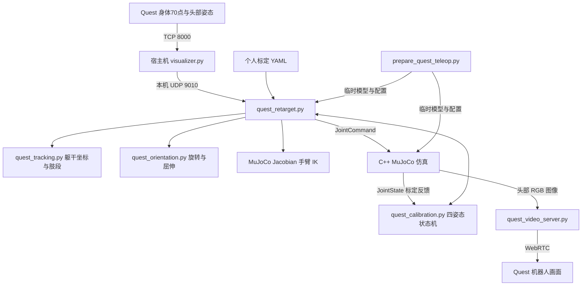

# Quest–PM01 手腕遥操作开发以及标定工作报告

**日期：2026-10-23**  
**项目：Learning_Based_Control / wholebody_teleop_ws**  
**代码基线：`33148a2`（生成报告前工作区无未提交改动）**  
**报告范围：今日讨论与实现的个人标定、手腕旋转与屈伸、头部俯仰、可视化及操作流程。**

本报告以当前代码为准，区分本轮新增功能与复用的既有基础。TCP 接收、UDP 转发、ROS 仿真、视频回传、个人位置映射和四姿态标定共同构成当前系统；最近一轮代码修改主要集中在腕部朝向、手掌屈伸、头部 pitch、运行时模型生成以及配套测试。报告不是实机性能认证，也不把用户现场确认与自动测试混为一谈。

## 1. 今日工作成果

| 工作项 | 需求与问题 | 当前实现 |
|---|---|---|
| 人体与机器人比例映射 | 真人臂长与机器人不一致 | 支持左右独立的上臂、前臂长度、比例及位置偏移；机器人参考长度来自 MuJoCo 正向运动学 |
| 高度处理 | 仅肩部相对位置不能反映人体升降 | 保存标定时人体肩高与机器人肩高，将人体肩高变化加入目标绝对 Z |
| 机器人引导标定 | 人模仿机器人动作完成采样 | 垂臂、前举、侧举、屈肘四姿态，采样后直接拟合、保存并跟随 |
| 标定视角 | 标定时不希望进入机器人第一人称 | 标定阶段延迟启动视频服务，使用 Quest 原视野及电脑 MuJoCo 全身窗口 |
| 原模型手腕旋转 | 希望原有末端能随手心转动 | 控制原有 `elbow_yaw_l_joint`、`elbow_yaw_r_joint`，不把它误称为原生三轴腕关节 |
| 固定 90° 偏差 | 双手始终存在朝向偏差 | 经用户现场确认，默认补偿为左 +90°、右 −90° |
| 手腕屈伸 | 原模型不能向掌心、手背方向弯折 | 每侧增加一个仿真屈伸关节，限位 ±60° |
| 手掌可视化 | 希望新增形状与机器人协调 | 低饱和灰色圆润手掌、深灰腕部连接件、背面与拇指轮廓 |
| 右手屈伸方向 | 现场发现右手弯折方向相反 | 去除右手额外符号反转，保留左右统一局部 +X 铰链定义 |
| 头部俯仰 | 支持抬头、低头 | 仿真增加 ±45° head pitch，头部网格与相机共同转动 |

当前仍为固定底座的上半身遥操作，没有行走、全身平衡、独立手指运动或手腕侧偏。新增屈伸与头部 pitch 为仿真扩展，不代表 PM01 实机拥有对应自由度。

## 2. 系统总体结构



控制链路和视频链路分别工作。收到追踪数据不等于收到视频，能看到视频也不代表控制器已经收到有效身体骨架。

| 接口 | 当前用途 |
|---|---|
| TCP 8000 | Quest 到宿主机原有追踪接收端 |
| `127.0.0.1:9010` UDP | 宿主机向遥操作桥接器转发身体与头部数据 |
| `/simulation/quest/joint_command` | 仿真关节命令 |
| `/simulation/quest/joint_state` | 仿真关节反馈，标定时用于机器人实际姿态 |
| `/simulation/head/image_raw` | 头部相机图像 |
| TCP 8765 | WebRTC 信令与浏览器预览入口，媒体另经 WebRTC 协商传输 |
| ROS domain | 启动脚本默认 87，沿用外部已设置的 ROS_DOMAIN_ID |

当前容器使用 host 网络，因此容器可接收宿主机本机 UDP 转发。换用其他网络模式时，不能直接沿用这一假设。

## 3. 文件职责与调用关系

以下路径均相对 `wholebody_teleop_ws`，宿主机追踪文件位于相邻的 `hand-tracking-streamer` 项目中。

| 文件 | 主要职责 | 本轮作用 |
|---|---|---|
| `scripts/run_quest_teleop.sh` | 环境加载、生成临时目录、配置预检、启动三类进程、退出清理 | 复用统一入口，自动带入新增模型和控制功能 |
| `scripts/prepare_quest_teleop.py` | 展开模型 include、修正资源路径、创建运行时关节与配置 | 新增 head pitch、左右屈伸、灰色手掌及相应执行器 |
| `scripts/quest_retarget.py` | UDP 接收、控制调度、双臂 IK、头部计算、ROS 发布 | 接入手腕模块、默认补偿参数和头部 pitch |
| `scripts/quest_orientation.py` | 四元数转换、前臂摆动消除、旋转分解、掌面屈伸 | 新增的腕部控制核心 |
| `scripts/quest_tracking.py` | 检查 70 点骨架、构造人体参考坐标、提取肢段 | 所有映射共用的数据基础 |
| `scripts/quest_body_profile.py` | 读取个人参数、校验配置、生成位置目标 | 保留人体比例与肩高映射 |
| `scripts/quest_calibration.py` | 示范姿态、采样状态机、比例拟合、原子保存 | 完成标定后增加腕部零位和头部平滑状态重置 |
| `scripts/quest_video_server.py` | ROS 图像到 WebRTC、标定就绪等待 | 延续标定期间不进入机器人视角的流程 |
| `scripts/tests/test_quest_orientation.py` | 腕旋转、屈伸、头部、限位、动力学测试 | 新增并随方向修正更新 |
| `scripts/tests/check_quest_teleop_live.py` | 实际 C++ 仿真与 ROS 反馈检查 | 扩展关节数量、腕旋转与头部验证 |
| `QUEST_TELEOP.md`、`QUEST_SIM_VIDEO.md` | 用户说明 | 同步运行方式与功能边界 |

`configs/quest_calibrated.yaml` 是个人实际采样结果；同名 `.report.yaml` 是诊断报告。二者不是通用算法源码，也不是所有使用者必须共享的参数。

## 4. 数据结构与坐标转换

### 4.1 输入数据

身体输入为 `Body joints_pose`，解析为形状 `(70, 7)` 的数组。每行依次是：

```text
[x, y, z, qx, qy, qz, qw]
```

位置单位为米。头部可另外提供 `Head pose`。解析器兼容包含帧号、时间戳的标签形式；身体输入必须包含完整的 490 个有限数值。

控制器使用的关键点如下：

| 部位 | 左侧索引 | 右侧索引 |
|---|---:|---:|
| 上臂起点/肩部参考 | 10 | 15 |
| 下臂起点/肘部参考 | 11 | 16 |
| 手腕 | 19 | 45 |
| 食指近端指根 | 25 | 51 |
| 中指近端指根 | 30 | 56 |
| 小指近端指根 | 40 | 66 |

躯干使用 hips 1、chest 5；头部骨骼使用 7。索引对应当前 Unity `BodyLandmarkStreamer.cs` 的发送顺序，不能直接换成另一种骨架枚举。

### 4.2 人体参考坐标

`body_features()` 以胸部减髋部构造躯干向上方向，左右肩连线去掉向上分量后得到“左”。“前”由叉乘构造。三行组成矩阵 B：

```text
B = [forward; left; up]
机器人参考下的向量 = B × Unity 向量
```

存在站立高度标定时，up 固定为 Unity 世界 +Y，使人体升降可稳定对应机器人 Z；没有该标定时，up 沿人体躯干方向。

Unity 与机器人坐标约定包含镜像，B 不是可直接作为四元数的普通旋转矩阵。腕部朝向转换使用 `B × R_wrist × diag(1, 1, -1)`，补偿坐标手性。

## 5. 位置映射、比例与高度

### 5.1 两种手臂控制模式

不传 `--body-profile` 时，采用肢段方向匹配。上臂和前臂向量会归一化，因此单纯放大输入长度不会改变方向目标。

传入个人配置后，使用保留长度的位置目标。对每侧手臂定义：

```text
u：人体肩→肘向量，已转换到参考坐标
f：人体肘→腕向量，已转换到参考坐标
Lu、Lf：机器人参考上臂/前臂长度
Hu、Hf：人体配置长度
gu、gf：配置倍率
be、bh：肘部与手端偏移

elbow_target = u × (Lu/Hu) × gu + be
hand_target  = elbow_target + f × (Lf/Hf) × gf + bh
```

机器人长度通过默认姿态下的 MuJoCo 正向运动学计算。手端仍使用 `elbow_yaw` body 下的近似点 `[0.03, 0, -0.14]`；新增灰色手掌不改变该位置任务的目标点。

### 5.2 Z 高度映射

标定保存第一姿态的人体肩部 Unity Y 和机器人肩部 Z，当前目标高度额外加入：

```text
robot_shoulder_z_reference
+ vertical_scale × (human_shoulder_y_now - human_shoulder_y_reference)
```

默认 `vertical_scale = 1.0`。因此人体下蹲、站高等肩部升降可影响目标 Z，而 X/Y 仍按肩部相对位置计算。

当前并没有直接填写“总身高”来推算地面高度；肩部追踪参考解决的是相对标定时站姿的高度变化。四个站立示范动作不能独立识别下蹲倍率，1.0 是明确的默认值，不是从四姿态中估计出来的结果。Quest 重新居中会改变追踪原点，应重新标定。

### 5.3 IK 求解

每侧手臂的位置 IK 使用四个关节：shoulder pitch、shoulder roll、shoulder yaw、elbow pitch。原有 elbow yaw 已交给腕部旋转计算，不再由位置 IK 同时争用。

每帧先计算腕部旋转，再执行手臂 IK。原因是原手端参考点存在局部偏移，elbow yaw 旋转也会改变它的位置。

每侧最多迭代 12 次，利用 MuJoCo Jacobian 建立误差方程：

```text
Δq = solve(JᵀJ + 0.04 I,
           Jᵀe + 0.015 × (q_rest - q))
```

位置模式下肘部与手端误差分别按 `sqrt(weight)/(Lu+Lf)` 缩放。默认肘部权重 0.5、手端权重 1.0。肩部自身会随上游关节运动，因此相对目标使用“目标点 Jacobian − 肩部 Jacobian”；绝对 Z 则使用目标点自身的 Z 行。

每次内部迭代的关节增量限制为 ±0.10 rad，并应用关节限位；最终输出另受统一速度限制。位置拟合受机器人的自由度和可达范围约束，不能保证所有人体姿态精确重合。

## 6. 手腕朝向模块内部逻辑

### 6.1 原有旋转关节

当前控制的原模型关节是 `elbow_yaw_l_joint` 和 `elbow_yaw_r_joint`，命令索引分别为 17、22，原限位约 ±150°。它们提供沿前臂方向的旋转，不提供屈腕。

`WristOrientation` 为每侧保存独立状态：初始手腕朝向、初始前臂方向、上一连续旋转角、平滑值、关节方向符号以及零位补偿。左右互不共用滤波状态。

计算步骤：

1. 检查手腕四元数并归一化，转为旋转矩阵。
2. 将手腕朝向和肘→腕方向转换到人体参考坐标。
3. 首个有效帧保存为旋转参考。
4. `swing_rotation()` 求初始前臂到当前前臂的最短摆动旋转。
5. 从手腕总变化中消除这部分摆动。
6. 将剩余旋转四元数的向量部分投影到初始前臂轴，提取轴向 twist。
7. 对 ±π 边界做连续角展开，避免角度跳变。
8. 按机器人实际关节轴与前臂方向的内积确定旋转正负。
9. 加入固定零位补偿、限位和平滑。

若前臂几乎反向，最短摆动平面不唯一，代码跳过该次轴向更新；无效腕部四元数也保持原指令。

### 6.2 固定零位补偿

```python
DEFAULT_WRIST_OFFSETS_DEG = (90., -90.)
```

此默认值来自用户在实际跟随中的确认。首帧人体朝向映射到补偿后的机器人零位，不是人体绝对手心朝向的自动识别。

```text
q_twist_target = offset + joint_sign × relative_twist
```

重新建立零位时以固定 offset 为基准，不把当前已带补偿的命令再次作为 offset，因此不会重复叠加 90°。

仍可使用 `--wrist-offset-deg LEFT RIGHT` 覆盖默认值。该参数是启动设置，不写入个人标定文件。

### 6.3 仿真屈伸的几何计算

屈伸使用位置而非单纯四元数轴分量。以食指与小指近端指根的连线定义掌面横轴 a，以腕到中指近端指根定义手掌向量 h，以肘到腕定义前臂向量 f。

将 h 和 f 投影到垂直于 a 的平面并归一化后：

```text
θ = atan2((f × h) · a, f · h)
q_flex_target = wrap_to_pi(θ - θ_first_valid)
```

首个有效掌面记录为屈伸零位，结果限于 ±60°并平滑。选取指根而非指尖，可以减少握拳、伸指对屈伸估计的影响；并不意味着追踪噪声完全不会影响掌面估计。

对几何退化情况保持原值，包括指根横向距离小于 0.015 m、投影后的掌长小于 0.02 m，或前臂投影接近退化。身体数据仍须满足整体有效性要求。

右手最初额外乘了 −1，用户反馈弯折反向。当前去掉这一额外反转：指根排列本身已经包含左右差异，两个仿真铰链均采用局部 +X。此修改只改变右手屈伸，不改变原有 `90 -90` 轴向补偿。

## 7. 运行时模型与视觉结构

`prepare_quest_teleop.py` 从原模型和配置生成临时 `scene.xml`、`ik.xml`、`config.yaml`。原模型 XML 和实机配置不被直接修改。IK 副本去除 sensor/extension，保留求解需要的动力学与几何结构。

| 命令索引 | 关节 | 用途 |
|---|---|---|
| 0–23 | 原有 24 个关节 | 原索引不变，其中 17/22 为轴向旋转，23 为头部 yaw |
| 24 | `sim_head_pitch_joint` | 仿真抬头、低头 |
| 25 | `sim_wrist_flex_l_joint` | 左手仿真屈伸 |
| 26 | `sim_wrist_flex_r_joint` | 右手仿真屈伸 |

新增自由度均有对应 motor，并同步追加命令配置的默认角度、刚度与阻尼。不能只改 XML 而不更新这些数组，否则发布维度会不一致。

| 参数 | head pitch | 每侧 wrist flex |
|---|---:|---:|
| 轴 | 局部 +Y | 局部 +X |
| 限位 | ±0.7854 rad | ±1.0472 rad |
| PD 刚度 | 15 | 8 |
| PD 阻尼 | 1.5 | 0.8 |
| 电机力矩范围 | ±15 N·m | ±4 N·m |

手掌 body 连接在原 elbow_yaw body 的 `[0.03, 0, -0.14]`。用椭球组成深灰腕部、灰色手掌、较暗手背和左右镜像的拇指轮廓，形成圆润的整体。

新增手掌几何的碰撞位设为 0，因此不参与接触。它仍有显式质量与惯量，并非完全没有动力学影响。最初每侧质量 0.10 kg 导致标定前举姿态反馈误差略超到位阈值；随后减为 0.02 kg并同比缩小惯量，相关测试通过。原有机器人碰撞几何没有因此删除。

## 8. 头部俯仰与相机

优先使用最近 0.15 秒内的独立 `Head pose`；若没有新鲜相机姿态，回退到身体数组中的 `Body_Head`。

两种数据的前向轴不同：Head 相机采用局部 +Z，Body_Head 骨骼采用局部 +Y。将前向视线投影到 forward、left、up 后计算：

```text
yaw   = atan2(lateral, frontal)
pitch = -atan2(vertical, hypot(lateral, frontal))
```

机器人 +Y pitch 的正向是低头，故 pitch 带负号。水平视线投影过小时保持 yaw，避免接近竖直视线时左右角不稳定。pitch 经平滑、±45°限位和统一速度限制。

新增 pitch 放在原 head_yaw body 上，因此头部网格与 head_camera 一起运动。Quest 看到的是该头部相机的单目画面，不是电脑 MuJoCo 观察窗口，也不是双目立体 VR。

## 9. 标定状态机与拟合

```text
waiting → moving → prepare → sampling
                               ↓
                     下一个姿态 / 拟合并保存
                               ↓
                       重置零位 → 正常跟随
```

四个示范为垂臂、前举、侧举、屈肘。机器人以最高 0.6 rad/s 移动；命令离目标不超过 0.005 rad、反馈离目标不超过 0.12 rad后进入准备阶段。准备 5 秒，随后采样约 3 秒。

这里的机器人到位判断用于确保采样对应示范姿态，**不是对真人模仿质量的验收**。按用户要求，不进行真人姿态匹配、稳定性评分、离群帧剔除、最低 45 帧要求或第五个验证姿态。采样窗口中的全部有效帧参与平均。

追踪或反馈超过约 0.2 秒不新鲜时暂停并重置当前采样窗口；非有限数、退化骨架仍不能进入拟合。使用实际反馈关节角计算机器人参考点，而不是直接把理想命令当作实际姿态。

每个肢段拟合一个标量比例和三维偏移：

```text
a = Σ[(x - mean(x)) · (y - mean(y))] / Σ||x - mean(x)||²
b = mean(y) - a × mean(x)
```

先拟合肘部，再用拟合出的肘部目标作为基础拟合前臂到手端。输入完全不变化、无法识别比例时使用零斜率与平均输出偏移。自动采样配置标记 `fit_mode: sampled`，允许有限的零/负比例，不以经验比例范围拒绝结果。

配置通过临时文件、flush/fsync和原子替换或原子链接保存。已有文件只有在明确传入 `--overwrite-calibration` 时才替换。诊断报告写入失败不会作废已经保存成功的主配置。

完成后加载个人配置，清空头部、手臂滤波状态和腕部参考，发出 tracking-ready 标记。视频服务随后启动，Quest 自动重连进入机器人画面。旋转补偿在正常跟随时生效；示范动作本身的 elbow_yaw 仍为 0，不能把示范姿态当成自动手掌朝向标定。

## 10. 控制循环与稳定措施

主循环目标频率为 60 Hz。每轮最多读取 256 个 UDP 包，消费最新身体帧，避免旧姿态积压或持续输入阻塞发布。每轮发布完整 27 维位置命令以及刚度、阻尼数组；速度、力矩和前馈力矩字段设置为 0。

平滑系数为：

```text
α = 1 - exp(-clamp(dt, 0, 0.05)/0.08)
```

平滑时间常数 80 ms。全部关节最后统一限制每步变化：

```text
|Δq| ≤ 1.5 × clamp(dt, 0, 0.05)
```

正常 60 Hz 下约为每步 0.025 rad。即便追踪恢复时 dt 很大，也不会直接跳到新目标。

没有新鲜身体数据时保持最后命令；超过 0.3 秒输出 stale 日志。这里是保持目标，不是停止发布或解除电机控制。标定模式另用 0.6 rad/s 的示范移动限速。

## 11. 实际操作步骤

### 11.1 目录与环境

本次使用的宿主机项目根目录为：

```text
/media/youran/3C50A006509FC554/Users/12911/Documents/Study/TUM/Masterarbeit/Learning_Based_Control
```

其下包含 `hand-tracking-streamer` 和 `wholebody_teleop_ws`。容器名称为 `wholebody_teleop_ws_devcont`，容器工作目录为：

```text
/workspaces/Learning_Based_Control/wholebody_teleop_ws
```

宿主机挂载位置可能改变，操作时以实际存在的目录为准；不要把宿主机路径当成容器内部路径。

### 11.2 启动追踪转发：宿主机终端

进入 `hand-tracking-streamer`，使用已配置的 `(hts)` Python 环境。停止旧 visualizer 后启动：

```bash
HTS_SIM_FORWARD_PORT=9010 python scripts/visualizer.py \
  --protocol tcp --host 0.0.0.0 --port 8000 --show-fingers
```

在 Quest 启用身体与手部追踪并开始 Streaming，沿用原 TCP 地址/端口。手掌屈伸需要有效指根位置，仅有手腕四元数不足以驱动新增屈伸。

### 11.3 进入容器

从宿主机开启容器终端，或使用现有开发容器终端：

```bash
docker exec -it wholebody_teleop_ws_devcont bash
cd /workspaces/Learning_Based_Control/wholebody_teleop_ws
```

如重建容器后缺少虚拟环境或 MuJoCo Python 包，执行：

```bash
bash scripts/setup_quest_teleop.sh
```

### 11.4 日常加载已有标定

先停止旧的遥操作或独立视频服务，再执行：

```bash
bash scripts/run_quest_teleop.sh --body-profile configs/quest_calibrated.yaml
```

脚本负责加载 ROS 环境、生成临时模型、预检配置并启动 MuJoCo、控制器和视频服务。无需重新编译 APK 或 C++ 来加载本次 Python/运行时模型修改。

开始时保持双手自然伸直及稳定的中立朝向，让第一个有效帧建立腕部参考。默认左 +90°、右 −90°补偿已经在代码中，不必重复传入。

### 11.5 重新进行四姿态标定

首次创建文件：

```bash
bash scripts/run_quest_teleop.sh --calibrate configs/quest_calibrated.yaml
```

替换已存在的标定：

```bash
bash scripts/run_quest_teleop.sh \
  --calibrate configs/quest_calibrated.yaml --overwrite-calibration
```

标定期间在电脑 MuJoCo 全身窗口看示范，Quest 保持原视野。按终端提示完成四姿态，采样结束后自动保存并进入跟随，无需额外验证或另开控制器。进入跟随时将手腕恢复自然伸直，建立新的腕部参考。

### 11.6 参数预检与临时调整

只检查配置，不启动仿真和视频：

```bash
bash scripts/run_quest_teleop.sh \
  --body-profile configs/quest_calibrated.yaml --check-profile
```

显式设置旋转补偿（通常不需要）：

```bash
bash scripts/run_quest_teleop.sh \
  --body-profile configs/quest_calibrated.yaml --wrist-offset-deg 90 -90
```

设为 `0 0` 可取消旋转补偿。它不调整屈伸方向，也不会替代身体位置标定。

### 11.7 视频查看与退出

浏览器可打开 `http://127.0.0.1:8765/preview` 查看头部相机；`/health` 可检查图像源是否就绪。Quest 视频需要可达的电脑局域网地址，USB 的 TCP 转发不等于 WebRTC 媒体可达。

在启动脚本终端按 Ctrl+C，脚本清理本次启动的子进程和临时模型。个人标定配置不会随临时目录删除。

## 12. 常见现象与处理

| 现象 | 检查与处理 |
|---|---|
| `No such file ... quest_body_profile.yaml` | 模板不等于个人文件；使用已生成的 quest_calibrated.yaml，或复制 example 后填写 |
| 一直 `Waiting for forwarded Body joints_pose` | 检查 Quest Streaming、完整70点输出、visualizer 转发环境变量、UDP端口及 host 网络 |
| `Tracking stale` | 身体流超过0.3秒未更新；恢复追踪后经限速继续 |
| 标定时没有机器人视频 | 这是当前流程；看电脑的 MuJoCo 全身窗口 |
| 正常跟随无视频 | 检查旧视频进程、8765端口、浏览器 health/preview、Quest Video Host与网络 |
| 双手固定偏转90° | 确认启动的是新代码且未用旧参数覆盖默认 `90 -90` |
| 旋转有效但屈伸不动 | 检查指根数据有效性，确认重启后运行时模型含27个命令关节 |
| 右手仍反向 | 停止旧进程后重启；最新代码已去掉右手屈伸的额外−1 |
| 启动后屈伸零位不自然 | 保持手腕自然伸直再重启，首个有效掌面会作为零位 |
| 标定后高度整体偏移 | 检查是否重新居中或改变追踪原点；重新采样 |
| 灰色手掌触碰物体不产生接触 | 新增部分是无碰撞可视化，符合当前实现 |

## 13. 验证记录及证据边界

本轮先完成37项遥操作测试全量通过，再在右手方向修正后完成9项朝向专项测试。编写本报告时重新运行最终代码的完整测试：**37项全部通过，耗时45.134秒**。

测试覆盖原关节索引保持、新增关节与可视化、默认旋转补偿、重置不累加、轴向旋转与屈伸分离、左右独立、整体转向不变性、四元数符号、无效数据保持、速度和位置限位、头部相机方向、PD动力学以及个人标定/视频相关逻辑。

实际 MuJoCo 离屏渲染已查看灰色手掌连接与弯折效果。曾出现新增质量导致标定示范误差超限的测试失败，减轻部件后通过，未放宽该测试阈值。

早先已执行实际 C++ 仿真的腕旋转与头部集成检查；最终27关节版本在该脚本中更新了关节数量断言，但本次报告整理没有重新运行这项GUI/ROS集成测试。该脚本也没有直接施加掌面屈伸输入，不能把它视为新增屈伸的端到端验证。

用户现场确认了默认 `90 -90` 旋转补偿，并指出右手屈伸反向；随后已完成代码修正与专项测试。最终方向仍以重启后真人动作和画面对应关系为现场依据，自动合成数据测试不能替代所有坐标约定的实测。

复现全量测试：

```bash
source /opt/ros/humble/setup.bash
source install/setup.bash
/home/devel/quest-video-venv/bin/python -m unittest discover \
  -s scripts/tests -p 'test_quest*.py'
```

软件回归测试与用户标定中的质量验收是两件事。本项目保留软件测试，没有重新加入用户已取消的标定验收步骤。

## 14. 交付与后续工作边界

本次功能包含原有手腕轴向旋转、默认角度补偿、两侧仿真屈伸、协调配色的手掌可视化及头部俯仰。控制和模型通过统一启动脚本加载，原有个人位置配置可继续使用。

仍需明确的限制：位置IK跟踪的是原近似腕部参考点，不是新增手掌末端或指尖；屈伸零位依赖首帧中立姿态；新增视觉部件没有接触功能；不支持腕部侧偏、手指抓取、实机新增自由度或全身平衡。追踪噪声、人体与机器人结构差异和关节限位仍会导致误差。

后续如扩展抓取，应另行定义手掌/指尖任务点、接触几何、质量惯量以及碰撞处理；如进一步改善朝向精度，可设计显式的手掌中立参考采样，并保存可复现的朝向参数。这些是后续建议，本报告不将其列为已实现功能。

生成报告前，代码位于提交 `33148a2`，Git工作区干净。此前审查的功能代码、测试、文档及个人采样文件已不再显示为未提交修改；本报告是新增加的交付文件。
