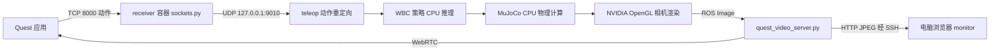

# 无线遥操作、服务器部署与 Quest 测试版发布工作报告

日期：2026 年 11 月 5 日  
项目：Learning_Based_Control  
核对基线：`v5` 分支，报告编写前 HEAD 为 `ba14255`（`test on VR and release 1.1`）。

## 1. 工作范围与当前结论

本轮围绕已有 Quest 遥操作系统开展了无线连接排查、服务器部署整理、Python 虚拟环境恢复、浏览器相机监控和 APK 测试版发布。原有的人体追踪、重定向、WBC、MuJoCo 和 WebRTC 框架继续复用；本轮没有重新设计机器人控制算法。

最终保留的部署方案是：Quest 直接向服务器发送动作；服务器通过两个容器运行接收程序与机器人仿真；头显通过原 WebRTC 链路接收机器人视角；电脑通过 SSH 转发查看新增的 HTTP 相机监控页面。开发和训练使用独立 Python 环境。

| 工作项 | 当前状态 | 证据与边界 |
|---|---|---|
| 大量 Git 修改排查 | 已完成诊断 | 当时 168 个文件仅 LF/CRLF 不同；不代表现在仍有这些修改 |
| Quest 无线 TCP 追踪 | 用户现场验证可用 | 无需将 TCP 改成 UDP |
| 无线机器人视频问题 | 用户确认解决 | APK 地址更新未同步到头显，重新安装后解决 |
| Docker 部署配置 | 已实现并纳入项目 | 最终 NVIDIA Xorg 路径仍需目标服务器验收 |
| 独立 ROS 编译 | 本机验证通过 | 补齐运行时必须安装的 pm01_description |
| 浏览器 HTTP 相机监控 | 已实现并验证 | 支持普通 SSH TCP 隧道，不是完整远程桌面 |
| hts 依赖清单与 venv 步骤 | 已整理 | 46 个固定版本依赖解析通过，未确认服务器完整安装 |
| 训练环境流程 | 已整理 | 复用 ics_rl_lab 的 uv.lock，未启动训练 |
| Quest 测试版 1 | 已归档并安装 | ADB 返回 Success，设备包信息复核通过 |
| saitama 容器部署 | 暂停 | youran 无 Docker socket 权限，也不在 sudoers 中 |
| MuJoCo/visualizer 窗口浏览器转发 | 未实现 | 讨论了 VNC/noVNC，未加入最终配置 |

本报告把“代码已准备”“本机已验证”和“服务器已运行”分开描述。不能把本机软件渲染测试、依赖 dry-run 或配置语法通过，当作目标服务器实时性能验收。

## 2. 问题排查与修复依据

### 2.1 Git 文件内容与换行符差异

首次检查时，当前分支为 v5，本地提交与 GitHub 远端分支都指向 `f1013d0`，即 11 月 4 日的 `Vendor ics_rl sources into main repository`。168 个修改文件全部位于 `ics_rl_lab/`。

对每个文件读取 HEAD 内容与工作区字节，将 CRLF 统一为 LF 后，168 个文件内容完全一致；没有实际代码差异，也没有暂存修改。Git 显示的大量删除与新增是换行转换造成的。诊断阶段没有恢复文件、修改 Git 设置或再次提交这些差异。

该结论是当时的仓库检查结果，不应作为以后忽略所有 Git 差异的理由。后续修改仍需正常 review。

### 2.2 从 USB 转为 Wi-Fi

TCP 是传输协议，不限定底层使用 USB、以太网还是 Wi-Fi。原 USB 流程借助 `adb reverse`，Quest 发送到自身的 localhost 后由 ADB 转发到电脑；无线流程则由 Quest 直接连接可达主机地址。

| 设置 | USB 调试流程 | 无线流程 |
|---|---|---|
| Quest 模式 | TCP Wired / ADB | TCP Wireless / WiFi |
| Quest 目标地址 | 127.0.0.1 | 电脑或服务器可达 IP |
| 接收程序绑定 | localhost 或全接口 | 0.0.0.0 |
| TCP 端口 | 8000 | 8000 |
| adb reverse | 需要 | 不需要 |

`0.0.0.0` 是服务端监听地址，不能填为 Quest 的目标地址。`127.0.0.1` 在头显中指头显自身，不是电脑。

本机曾使用 `10.181.230.54`，Quest 曾使用 `10.181.170.61`。这些是排查时地址，不是项目永久配置。TCP 8000 建连只证明追踪端口可达，不证明 TCP 8765 或 WebRTC 媒体可达。

### 2.3 “动作正常但没有机器人视角”的根因

系统存在相互独立的追踪通道与视频通道。排查时，曾观察到 TCP 8000 的多个 Quest 连接正常，视频服务 `/health` 返回：相机就绪、1280×720 图像、图像年龄为几十毫秒；但没有来自 Quest 的视频连接。

检查 APK 二进制资源后，发现当时 APK 仍包含旧视频地址 `10.181.229.242`，而电脑地址和 Unity 场景已更新到 `10.181.230.54`。用户随后确认：修改后的 APK 没有同步安装到 VR 设备，安装更新后问题解决。

中间另有几次检查发现全部服务停止，用户解释当时已关闭机器人。因此“服务停止”是检查时状态，不能据此判断先前无画面的唯一原因。

Unity 的 `VideoStreamManager.ResolveHost()` 规则是：Video Host 非空时使用显式值，留空时才跟随 `AppManager.ServerIP`。因此只修改追踪地址，并不会覆盖一个已经固定的视频地址。当前测试版仍保留显式视频地址；服务器迁移版应重新检查此项。

## 3. 最终系统架构



| 接口 | 用途 | 是否由普通 SSH TCP 隧道完整支持 |
|---|---|---|
| TCP 8000 | Quest 追踪数据 | 可以，但最终方案是 VR 直连，不转发 |
| UDP 127.0.0.1:9010 | 同一服务器内部动作转发 | 不需要 SSH；容器共享 host 网络 |
| ROS topic | 重定向、控制、状态与图像 | 限制在本机，使用相同 ROS domain |
| TCP 8765 | HTTP 和 WebRTC WebSocket 信令 | HTTP/信令可以 |
| ICE 协商媒体连接 | Quest/WebRTC 视频数据 | 不会随普通 SSH -L 自动转发 |
| 电脑 127.0.0.1:18765 | 本地浏览器隧道入口 | 对应服务器 127.0.0.1:8765 |

这套架构面向仿真。将来接实体机器人时，需要独立验证硬件通信、控制频率和停止机制，不能把仿真入口直接当作实机部署入口。

## 4. 当前新增文件与设计职责

### 4.1 deployment/quest 最终文件

| 文件 | 功能 |
|---|---|
| Dockerfile | 在既有机器人基础镜像上补充 Python venv、视频与图形检查依赖 |
| Dockerfile.dockerignore | 限制 Docker 构建上下文，避免传入 Unity Library、模型等无关大文件 |
| compose.yml | 声明 build、receiver、teleop 服务，网络、卷、GPU、健康检查 |
| container-entrypoint.sh | 统一处理 build、receiver、run 三类入口 |
| requirements-container.lock.txt | 容器 Python 3.10 依赖版本快照及显式覆盖 |
| requirements-hts.lock.txt | 原 hts 的 46 个按包名安装的 pip 包版本 |
| environment-hts.yml | 保留的 Conda 兼容配置；当前推荐流程不使用它 |
| .env.example | 镜像名、构建并行度、端口、ROS domain、Xorg 参数模板 |
| .gitignore | 排除本机 .env |
| README.zh-CN.md | 唯一主部署说明，含无 sudo 的 uv/venv 流程 |

相机监控还新增了 `wholebody_teleop_ws/scripts/quest_video_monitor.html`，修改了 `quest_video_server.py` 和 `requirements-quest-video.txt`。APK 发布资料位于 `hand-tracking-streamer/releases/`。

精简过程中删除了独立打包工具、重复文档、额外 GPU 覆盖文件、软件渲染入口和迁移大归档。GPU 配置并入主 Compose。此前生成的约 6.1 GB 镜像归档和约 157 MB 源码归档已经删除，不是当前交付物。原软件渲染用到的 `prepare_quest_teleop.py` 临时预设也已撤回。

hts 环境文件是在用户明确需要开发与训练虚拟环境后重新加入的，不是 Docker receiver 的运行前提。

### 4.2 基础镜像与应用镜像分层

`wholebody_teleop_ws/docker/engineai.Dockerfile` 是既有基础环境，负责 ROS Humble、编译工具链、第三方机器人库以及相关数值/推理组件。本轮复用该环境，不把它与新增 Dockerfile 混为一次全新实现。

新增 `deployment/quest/Dockerfile`：

1. 通过 `BASE_IMAGE` 指定基础镜像，默认 `engineai-devel-vscode:latest`。
2. 安装 Python 3.10 venv 支持和 OpenGL 检查工具。
3. 建立 `/opt/quest/venv`，使用 `--system-site-packages` 复用系统 ROS Python 模块，例如 rclpy。
4. 从锁定清单安装视频和控制依赖；显式固定 NumPy 1.26.4、ONNX Runtime 1.23.2、SciPy 1.15.3、Pillow 12.3.0。
5. 构建中导入关键模块，并检查 NumPy 版本，尽早暴露 ABI/依赖问题。
6. 设置 `QUEST_VIDEO_PYTHON` 指向新 venv，避免沿用旧开发容器的 `/home/devel/quest-video-venv`。
7. 使用统一 entrypoint，默认命令为 `run --wbc`。

其他重要锁定版本包括 Python MuJoCo 3.3.7、aiortc 1.15.0、aiohttp 3.14.5、PyAV 17.1.0。C++ 仿真使用 `/opt/engineai_robotics_third_party` 中的 MuJoCo，已有本机运行版本为 3.2.3；它不等于 Python 的 mujoco 包版本。

`--system-site-packages` 表示环境仍继承基础镜像的系统包。因此这份锁文件不是完整的系统镜像锁定；原基础 Dockerfile 也存在外部下载和未完全固定的来源，不能承诺从零构建按位可复现。

### 4.3 Compose 三个服务

**build** 是一次性工具服务，放在 tools profile 中，通过 `docker compose run --rm build` 显式执行，不随普通 up 自动运行。

**receiver** 调用 entrypoint 的 receiver 分支，运行原 `sockets.py`。它不依赖宿主机 Conda/venv，不需要 GPU。接收主机与端口从环境变量读取，默认 0.0.0.0:8000，转发端口固定为 9010。

**teleop** 调用 `run --wbc`。GPU 配置为 `gpus: all`，驱动能力包括 compute、utility、graphics、display；挂载 X11 socket 和授权文件。启动前检查 OpenGL vendor，不满足 NVIDIA 要求时退出，而不是回退到已知缓慢的软件渲染。

三类服务使用 Linux `network_mode: host`。因此两个容器都能通过同一主机的 127.0.0.1:9010 通信，不依赖 Docker bridge 端口映射。默认 `ROS_DOMAIN_ID=87`、`ROS_LOCALHOST_ONLY=1`，将 ROS 通信维持在同机范围。

仓库只读挂载到 `/workspaces/Learning_Based_Control`，build/install/log 使用独立命名卷。这样避免容器改写源码，避免复制旧主机的绝对路径编译产物。运行时临时场景仍可写入容器 `/tmp`。在程序中向仓库配置目录保存标定数据可能因只读挂载失败，需显式设计可写输出位置或在主机编辑配置；不能假定整个仓库可写。

其他设置：`init: true` 管理子进程；`shm_size: 1gb` 提供共享内存空间；`stop_grace_period: 20s` 给退出清理留时间；`restart: no` 不自动重启仿真。

健康检查每 15 秒访问 `/health`，要求 `source_ready=true`；启动宽限为 60 秒，连续失败会标记 unhealthy。健康状态不会自动重启服务，也不能证明 Quest 端已经显示画面。

### 4.4 container-entrypoint.sh 逐分支说明

| 分支 | 实际行为 | 设计原因 |
|---|---|---|
| 初始化 | 进入固定容器工作目录，source ROS Humble | 统一不同启动位置 |
| build | colcon sequential 构建 mujoco_simulation、pm01_description 及依赖 | 降低并发内存压力；安装运行时资源 |
| 构建验证 | source install，再导入 JointCommand 和主要模块 | 不只检查编译进程退出码 |
| receiver | exec Python 接收脚本，传入 TCP/转发参数 | 与原命令等价，避免多余 shell 层 |
| run | 检查 install、DISPLAY、XAUTHORITY、NVIDIA OpenGL，然后 exec 原启动脚本 | 在真实渲染前明确失败原因 |
| 其他命令 | exec 用户指定命令 | 支持容器内诊断与临时命令 |

独立编译最初只包含仿真依赖，运行时曾出现 `Failed to find ros pkg: 'pm01_description'`。原因是皮肤/模型插件通过 ROS 包索引访问资源，而不仅仅读取绝对 XML 路径。将该资源包显式加入构建后，模型能够加载。这是本轮部署验证发现并修正的实际缺项。

## 5. 原有脚本在新部署中的作用

### 5.1 sockets.py：接收与转发

这是既有功能，本轮主要把它纳入 Docker 启动，不把其历史实现全部算作新增。

- `run_tcp_server()`：绑定监听地址，多线程处理 Quest 的多个连接。
- `handle_tcp_connection()`：TCP 是字节流，代码用 buffer 按换行重组完整消息，支持一条记录被拆成多个 recv，或一次 recv 包含多条记录。
- 每条记录去除行尾 CR，空行不计数；断开时丢弃不完整的末尾记录；未完成记录超过约 1 MiB 时关闭该连接。
- `--tally` 在 TCP 模式统计完整消息数，不等于人体完整帧数，也不等于网络分包数。
- `PoseForwarder.send()` 识别 Body joints_pose、Head pose、Locomotion reference、Left/Right controller_wrist，原样转发相关记录，保留元数据。
- UDP 转发 socket 非阻塞，模拟器不可用时不阻塞追踪接收；这不提供必达保证。
- 仍支持原 UDP 接收模式，但最终 Compose 选择 TCP。

脚本仍固定打印 `adb reverse` 提醒；该提醒只适用于 USB，Wi-Fi 直连时忽略，不是启动失败。

### 5.2 visualizer.py：人体骨架窗口

`visualizer.py` 同时提供追踪接收、Matplotlib 人体/手指绘图，以及可选的本机 UDP 转发。它不是新增 HTTP monitor 页面的后端。

若改用它接收数据，必须停止 receiver，不能与 sockets.py 同时占用 8000。原命令为：

```bash
# 有图形会话、已激活 hts；位于 hand-tracking-streamer 目录
HTS_SIM_FORWARD_PORT=9010 python scripts/visualizer.py \
  --protocol tcp --host 0.0.0.0 --port 8000 --show-fingers
```

浏览器操作这个完整窗口需要 VNC/noVNC 或另行实现网页骨架渲染。本轮只讨论了方案，没有安装 VNC、没有提供 6080 服务，也没有完成服务器图形会话转发。仅运行 Python 命令不会自动出现浏览器窗口。

### 5.3 run_quest_teleop.sh：原有统一启动器

部署 entrypoint 最终调用该脚本，保留原有行为：

- 默认固定基座追踪，也支持 `--walk`、`--run`、`--wbc` 互斥模式。
- 支持指定 ONNX 模型、速度参数、个人标定、upper-only 等选项。
- 检查 Python 模块，生成临时运行场景并验证个人配置。
- 在 WBC 模式启动策略进程，再启动 MuJoCo、动作重定向与视频服务。
- 等待子进程退出并清理同次启动的其他进程和临时目录。

`prepare_quest_teleop.py` 生成临时场景、扩展仿真关节和控制配置；`quest_retarget.py` 把 Quest 参考转换到机器人参考；`quest_policy.py` 加载模型并执行推理。详细控制算法仍以既有全身遥操作报告与源码为准。本轮没有修改这些控制算法。

`run_quest_sim_video.sh` 仍在原项目中，用于独立显示测试；最终精简 Compose 不再单列一个 video 服务。`setup_quest_video.sh` / `setup_quest_teleop.sh` 仍可用于旧开发容器的手工准备，但新部署镜像已安装相应依赖，不需要重复执行它们。

## 6. 浏览器 HTTP 相机监控的代码设计

### 6.1 为什么新增 HTTP 页面

原 `/preview` 使用 WebRTC。SSH `-L` 能转发网页与 WebSocket 信令，却不会自动转发 ICE 选择的 UDP 媒体端点。此前“页面能打开但没有画面”的问题不能仅靠再转发一个 HTTP 端口解决。

新增 `/monitor` 通过普通 HTTP 请求 JPEG 快照，使“电脑浏览器看相机”只需一个 SSH TCP 隧道。该页面定位为监控和调试，不取代头显低延迟 WebRTC，也不是远程桌面。

### 6.2 图像源与原 WebRTC 复用

`image_array()` 支持 rgb8、bgr8、rgba8、bgra8，校验图像尺寸、步长和数据长度，并处理行填充及通道顺序。

`ImageSource` 使用 sensor-data QoS 订阅 `/simulation/head/image_raw`。回调保存最新数组、接收时刻和递增序号，使用线程锁保护共享状态；不积压历史图像。

`RosVideoTrack.recv()` 为 WebRTC 等待新的、年龄小于 2 秒的图像，使用单调时间生成递增 PTS，并维护发送帧/跳帧统计。WebRTC 原链路继续保留，不因新增 HTTP 监控改变接口。

### 6.3 新增 VideoServer 方法

**`monitor()`**：返回 `quest_video_monitor.html` 静态页面。

**`encode_snapshot(image)`**：将 NumPy 图像转换为 Pillow 图像；用 thumbnail 将尺寸限制在 960×540 范围内且保持比例；以 JPEG quality=75 编码到内存。缩放后的监控尺寸不代表 ROS 原图尺寸发生变化。

**`snapshot()`**：

1. 获取 `asyncio.Lock`，让多个浏览器共享一次编码结果。
2. 读取当前最新图像和序号；尚无图像时返回 HTTP 503。
3. 只有序号变化时才重新编码；通过 `asyncio.to_thread()` 将 JPEG 处理放到工作线程，减少对同一事件循环内 WebRTC 的阻塞。
4. 缓存 JPEG 和对应序号，不建立历史帧队列。
5. 返回 `image/jpeg`，附加 `Cache-Control: no-store`、`X-Frame-Sequence` 和 `X-Frame-Age`。

锁保证同一时刻不会重复编码相同源帧。JPEG 编码期间源图像可以继续更新，下一次请求再获取最新帧。大量浏览器仍会增加 HTTP 请求与发送带宽；本轮没有做多用户容量测试。

快照接口允许返回最后一张旧图，并在 header 中报告图像年龄；这与要求图像新鲜的 `/health` 和 WebRTC 不同，目的是在断流时保留诊断画面且明确标记其陈旧状态。

### 6.4 HTTP 接口清单

| 路径 | 返回内容 | 用途 |
|---|---|---|
| `/` | WebSocket 信令 | Quest/原 WebRTC 客户端 |
| `/preview` | 原 WebRTC 网页 | 网络媒体可达时低延迟预览 |
| `/monitor` | 新 HTTP 监控网页 | SSH 单端口查看 |
| `/snapshot.jpg` | 最新/最后一帧 JPEG，或无图像时 503 | 轮询与截图 |
| `/health` | source_ready、image_age_seconds、frames_received、width、height | 服务端源状态 |

图像年龄从服务器收到 ROS 图像时计算，不是相机曝光到浏览器显示的端到端延迟。health 不包含 Quest 是否成功解码的证明。

### 6.5 前端刷新与状态管理

`quest_video_monitor.html` 不依赖额外前端框架。`refresh()` 使用 fetch 获取 JPEG，设置 5 秒请求超时，完成请求后间隔 500 ms 再请求，因此每个页面最多约 2 次/秒，实际频率还受网络与编码耗时影响。

- `busy` 防止同一页面并发堆积请求。
- `AbortController` 取消超时、暂停或切到后台的请求。
- Blob URL 用于展示图像，替换后回收旧 URL，避免持续泄漏。
- 收到的 `X-Frame-Age` 超过 2 秒时，画面降低透明度，状态提示旧图像。
- 503 显示“等待相机图像”，网络错误或超时提示后继续重试。
- 暂停按钮停止轮询，保留最后画面并明确标记暂停。
- `visibilitychange` 暂停后台刷新，`pagehide` 清理资源，`pageshow` 恢复。

页面没有机器人控制按钮。暂停刷新只停止网页请求，不会停止仿真或机器人控制。状态年龄不是持续更新的延迟测量仪；它是每次成功响应时读取的源图像年龄。

### 6.6 Python 依赖变更

新增 `from PIL import Image as PillowImage`，因此普通视频安装清单加入 `Pillow>=10,<13`，部署锁文件固定为 `Pillow==12.3.0`。原有环境镜像已包含该版本，但新的从零安装不能依赖偶然的传递依赖，所以明确声明。

## 7. 三类 Python 环境与 GPU 使用范围

### 7.1 环境隔离

| 环境 | 位置 | Python / 关键依赖 | 任务 |
|---|---|---|---|
| Docker 运行环境 | 容器 `/opt/quest/venv` | Python 3.10、NumPy 1.26.4、MuJoCo Python 3.3.7 | ROS、控制、视频 |
| hts 开发环境 | 用户 `~/.venvs/hts` | Python 3.13、NumPy 2.2.6、MuJoCo 3.11.0、ONNX Runtime 1.28.0 | SDK、数据处理、录制、可视化 |
| ICS 训练环境 | `ics_rl_lab/.venv` | 按项目 uv.lock；MuJoCo 3.6.0、Torch 2.10.0 等 | 模型训练与相关实验 |

不能因为三个环境都叫 Python，就把它们的依赖合并。ROS Humble 的 ABI 需求、hts 现有包和训练栈的版本要求不同。

### 7.2 hts 快照与不可移植项目

锁文件保留 46 个按包名安装的 pip 包，包括 hand-tracking-sdk、NumPy、SciPy、Matplotlib、PyQt5、pyqtgraph、MuJoCo、ONNX Runtime、PyOpenGL、Redis、Rich 等，以及其原环境依赖版本。

以下两项未作为旧绝对路径写入锁文件：

- `pose`：editable 安装指向旧电脑 `TWIST2/pose`。该源码不在本轮迁移目录，使用它前需要提供真实源码位置。
- `quest-wrist-tracker`：旧 editable 安装指向 `/home/youran/hand-tracking-streamer`。当前 pyproject 要求 NumPy ≥2.4.2，而实际 hts 是 2.2.6，存在声明与现实不一致。直接执行脚本不必安装这个项目元数据；如需要 package 安装，应先确认依赖要求，不能用 `--no-deps` 掩盖冲突。

`isaacgym-stubs` 只是接口 stub，不是完整 Isaac Gym。46 个包并不包括 PyTorch，因此恢复 hts 不等于完成训练环境安装。

Conda YAML 仍作为已有 Conda 用户的兼容文件保留。saitama 没有 conda，且用户选择普通虚拟环境，因此主文档改为 uv 安装用户级 Python，再创建 venv；没有要求服务器管理员安装 Conda。

### 7.3 GPU 与 CPU 的真实分工

| 工作部分 | 当前实现 |
|---|---|
| TCP/UDP 接收与转发 | CPU |
| 标准 MuJoCo 物理步进 `mj_step` | CPU |
| MuJoCo OpenGL 渲染 | 最终部署要求 NVIDIA GPU |
| `quest_policy.py` WBC ONNX 推理 | 显式 `CPUExecutionProvider` |
| HTTP JPEG 编码 | Pillow CPU 编码 |
| WebRTC 编码 | 本轮未配置或验证 NVENC 硬件编码 |
| ICS 训练 | 配置未指定设备时优先检测 CUDA，代码选择 cuda:0 或 cpu |

`gpus: all` 仅授予容器访问 GPU 的条件，不会自动把 CPU 推理、网络处理或普通 MuJoCo 物理运算变成 CUDA。

训练入口把选择的 device 传给环境和 runner，并打印设备。需要结合 `torch.cuda.is_available()`、训练日志和 nvidia-smi 共同确认实际运行；仅检测 CUDA 可用不等于训练已经开始。当前 mjlab/Warp 栈能否在无 CUDA 下完成运行，也不能仅由设备选择的 cpu 分支推断。

## 8. 服务器显示环境、权限与浏览器窗口边界

### 8.1 NVIDIA_DISPLAY 与 NVIDIA_XAUTHORITY

`.env.example` 中 `NVIDIA_DISPLAY=:0` 表示 Xorg 显示会话编号，不是 GPU 编号，也不是服务器 IP。`:0` 只是默认示例，实际值由服务器配置决定。

`NVIDIA_XAUTHORITY` 是主机上的 Xorg 授权文件路径，Compose 将其只读挂载为容器 `/run/quest-xauth`。程序读取该文件以获得连接显示会话的授权。`create_host_path: false` 防止缺失文件被自动创建为目录。

复制 `.env.example` 不会启动 Xorg，也不会产生有效授权文件。SSH `-X` 得到的 `localhost:10.0` 属于 SSH X11 转发，不等于本方案需要的服务器 NVIDIA Xorg。

### 8.2 实际服务器阻塞情况

用户在 saitama 构建时，首先收到 Docker socket permission denied；尝试 sudo 后收到 `youran is not in the sudoers file`。因此远程 Docker 构建没有开始，不能宣称服务器已部署。

需要管理员开通现有 Docker 使用权限或提供允许的容器运行方案。Rootless Docker、Apptainer 等只是可能选项，并未在本项目实现对应转换。Python venv 可在用户目录创建，但不会提供 Docker 权限、内核驱动或 ROS/C++ 系统库。

### 8.3 完整窗口转发

HTTP monitor 只显示机器人相机。MuJoCo 可交互窗口和 visualizer 人体骨架窗口若要在浏览器操作，需要 VNC 捕获它们实际所在的显示会话，再由 noVNC 转换成浏览器访问。

此方案尚未部署。没有实际 noVNC 服务时，单独执行 SSH 6080 转发不会产生网页。VNC 必须连接对应 Xorg 显示环境；另建一个与 MuJoCo 无关的虚拟桌面不会自动显示原窗口，也不能保证 NVIDIA GPU 渲染。

## 9. Quest 测试版 1 的冻结、校验和安装

### 9.1 归档内容

归档目录：[test-2026-11-05](../hand-tracking-streamer/releases/test-2026-11-05/README.zh-CN.md)。

| 字段 | 值 |
|---|---|
| 发布标记 | 1.1.0-test.1 |
| APK 文件名 | Quest-Control-1.1.0-test.1.apk |
| 头显应用名称 | hand-tracking-streamer |
| Android versionName | 1.1.0 |
| Android versionCode | 7 |
| 包名 | com.wengmister.handtrackingstreamer |
| 架构 | arm64-v8a |
| 签名 | Android Debug，APK v2 签名验证通过 |
| 文件 SHA-256 | e0feb830fecfa1c67f363b567bb0f2b0151edb366f0a3ea14912c4badd003335 |

本次是冻结现有已构建 APK，不是重新编译一个内部版本号带 beta 的应用。文件名 test.1 不会修改 Android 内部版本、应用名称或签名。

归档 APK 被 releases 下的 .gitignore 忽略，说明和校验清单可以进入 Git。现有主 APK 仍在原路径。将来从 GitHub clone 可能有发布说明而没有归档 APK；需要从保存的归档副本分发，或使用对应构建产物并核对哈希，不能只按名字假定是同一版本。

### 9.2 已完成安装

Quest 3 通过 USB/ADB 授权连接后，从正确的发布目录执行校验，结果 OK。随后使用明确的设备序列号执行 `adb install -r`，返回 `Success`；再通过 `pm path` 与 `dumpsys package` 检查包已安装，versionCode=7、versionName=1.1.0，最后更新时间为 2026-11-05 17:12:47。

安装使用覆盖更新方式，没有执行卸载。该记录证明此 APK 已安装并登记在设备中，不等于重新完成全部动作和视频现场验收。

头显中的应用会保留，平时从应用库的“未知来源”启动，无需每次打开 Unity。只有修改代码、场景或固化的视频配置时才需要重新构建安装。应用常驻头显不代表仿真也在头显运行；电脑或服务器接收、仿真、视频服务仍需启动。

### 9.3 测试版配置限制

当前测试版资源中含视频地址 `10.181.230.54`。它是当前电脑测试版本，不是已完成服务器地址适配的版本。未来转到 saitama，应检查 Video Host，建议留空以跟随追踪 Server IP，或填写头显可达的服务器地址，并重建安装。

## 10. 后续操作方法

下列命令明确区分服务器与本地电脑。仓库路径按实际位置调整，不要在新主机照抄旧电脑的挂载盘绝对路径。

### 10.1 无 sudo：先建立 hts 环境

在服务器普通用户终端执行：

```bash
curl -LsSf https://astral.sh/uv/install.sh | sh
export PATH="$HOME/.local/bin:$PATH"
uv python install 3.13
uv venv --python 3.13 --seed "$HOME/.venvs/hts"
source "$HOME/.venvs/hts/bin/activate"
cd ~/Learning_Based_Control/deployment/quest
python -m pip install -r requirements-hts.lock.txt
python -m pip check
python -c "import numpy, scipy, mujoco, onnxruntime, matplotlib; print('hts dependencies OK')"
```

已有同路径环境时先确认用途，不覆盖；可以改用 `~/.venvs/hts-server`，并同步修改激活路径。以后只需 source activate，退出用 deactivate。安装包仍需要联网访问对应包源。

### 10.2 独立训练环境

在新终端操作；若已激活 hts，先 deactivate：

```bash
export PATH="$HOME/.local/bin:$PATH"
cd ~/Learning_Based_Control/ics_rl_lab
uv sync --locked
uv run --locked python -c "import torch, mujoco; print(torch.__version__, mujoco.__version__); print('CUDA:', torch.cuda.is_available())"
uv run --locked scripts/train.py --help
```

实际任务训练参数继续遵循 ICS 项目 README。先验证 GPU、任务和小规模运行，再扩大并行环境数。本轮未启动模型训练。

### 10.3 权限与显示就绪后部署容器

先在服务器确认 Docker 可用，并由管理员提供 NVIDIA Xorg 显示编号和授权文件。之后在仓库根目录：

```bash
docker build -f wholebody_teleop_ws/docker/engineai.Dockerfile \
  -t engineai-devel-vscode:latest wholebody_teleop_ws/docker
cd deployment/quest
cp .env.example .env
# 编辑 .env，填写真实 NVIDIA_DISPLAY / NVIDIA_XAUTHORITY
docker compose build teleop
docker compose run --rm build
docker compose up -d receiver teleop
docker compose logs --tail=100 receiver teleop
```

已有 .env 不应再次覆盖。首次基础镜像构建会下载较多工具链，需足够磁盘与网络。环境镜像构建、ROS 编译和运行服务是三个不同步骤。

### 10.4 日常启动、停止、检查

在服务器 deployment/quest 目录：

```bash
docker compose up -d receiver teleop
docker compose ps
docker compose logs -f receiver
# Ctrl+C 退出日志查看，不会停止容器
curl http://127.0.0.1:8765/health
docker compose exec teleop glxinfo -B
nvidia-smi
# 使用结束后
docker compose down
```

不要随意追加 `down -v`，否则会删除编译卷。后台容器运行不依赖 SSH 会话持续连接。

### 10.5 Quest 无线直连与电脑浏览器

头显填写服务器实际可达 IP，端口 8000，启用 TCP Wireless；同时核对视频目标地址。电脑不需要另起 sockets.py，也不需要动作端口 SSH 转发。

电脑浏览器监控使用：

```bash
ssh -N -o ExitOnForwardFailure=yes \
  -L 127.0.0.1:18765:127.0.0.1:8765 youran@saitama
```

打开 [本地监控入口](http://127.0.0.1:18765/monitor)。保持隧道终端运行。关闭隧道只会断开浏览器查看，不停止服务器仿真。若电脑能直接访问服务器，可直接使用服务器地址。

### 10.6 安装或复装测试 APK

在连接 Quest 的本地电脑，进入归档目录后：

```bash
cd ~/你的项目路径/hand-tracking-streamer/releases/test-2026-11-05
adb devices -l
sha256sum -c SHA256SUMS
adb -s 设备序列号 install -r Quest-Control-1.1.0-test.1.apk
adb -s 设备序列号 shell pm path com.wengmister.handtrackingstreamer
```

`SHA256SUMS` 在归档子目录而不是 hand-tracking-streamer 根目录；此前“没有那个文件”就是工作目录错误。只有 device 状态才能安装，unauthorized 需在头显内允许 USB 调试。

### 10.7 发布下一版

1. 修改 Unity 项目并完成本机功能检查。
2. 在 Android Player Settings 中更新 Version，例如 1.1.1；Bundle Version Code 从 7 增加到 8，后续继续递增。
3. 保持包名和签名密钥一致；换构建电脑时确认签名一致。
4. 构建新的 APK，使用独立发布目录，保存版本说明和 SHA-256。
5. 用相同签名的 `adb install -r` 覆盖安装，复核设备版本，再测试追踪、视频和关机后重新打开。
6. 若签名不兼容或版本降级失败，先检查签名与 versionCode，不直接卸载；卸载可能删除应用设置。

仅重命名 APK 不改变内部版本。当前 Debug 签名适用于内部测试；未来正式分发需要单独制定发布签名与密钥管理方案。不要把私钥/keystore 写入 Git。

### 10.8 按改动类型更新服务器

| 改动 | 操作 |
|---|---|
| HTML monitor 页面 | 拉取代码后刷新网页；遇到缓存先重新加载 |
| Python 视频/控制脚本 | 拉取代码并重启对应服务 |
| C++、ROS 消息或资源包 | 停止 teleop，重新 run --rm build，再启动 |
| Dockerfile / 容器依赖 | 重建镜像，再用 up -d 重建使用该镜像的服务 |
| .env 显示或端口参数 | 用 up -d 应用新配置，核对实际连接 |
| hts 包需求 | 在独立 hts 中安装/校验，不修改 ROS 容器环境 |
| Unity 场景/脚本 | 重建 APK 并安装到头显 |

## 11. 验证记录与排错顺序

### 11.1 已完成的验证

- Git：逐文件字节比较确认当时 168 项仅换行差异；实时查询远端分支提交一致。
- Docker：在现有基础镜像上构建部署层，并使用独立命名卷完成 5 个 ROS 包构建与模块导入。
- 无桌面探索：Xvfb/Mesa 能生成相机图像，aiortc 客户端实际收到并解码 640×360 帧；但软件渲染约每秒不到一帧，不能满足实时遥操作，因此该方案已从最终配置移除。
- 转发：使用拆分 TCP 消息检查完整记录重组，并验证本机 UDP 转发内容。
- HTTP：原有 4 项视频测试与新增 3 项快照测试在开发时通过，覆盖无源 503、JPEG 尺寸、旧帧年龄、并发缓存与页面返回。
- 浏览器：使用合成图验证页面加载、暂停、恢复刷新。该检查没有冒充真实机器人相机现场效果。
- hts：pip dry-run 忽略既有安装，46 个固定版本能够解析；未实际替换原环境。
- APK：aapt 元数据读取、apksigner v2 验证、SHA-256 校验、ADB 覆盖安装与安装版本查询通过。

此前新增的独立 HTTP 测试文件和 VALIDATION.md 在用户要求精简后已删除；这里记录的是当时执行结果，不能要求读者在当前仓库直接运行已经移除的测试文件。原有视频测试仍以项目现有目录为准。

最终 GPU Xorg 入口只完成了代码/配置检查，目标服务器的驱动、授权、GPU 性能和跨网络视频没有完成现场验收。原基础镜像从零构建也未在本轮重新执行。

### 11.2 推荐排查顺序

| 现象 | 优先检查 |
|---|---|
| docker socket permission denied | Docker 使用权限；与 Python 依赖无关 |
| not in sudoers | 由管理员处理，venv 不能绕过 |
| conda not found | 使用文档 uv/venv 流程，不必安装 Conda |
| teleop 在显示检查处退出 | DISPLAY、授权文件、Xorg、NVIDIA OpenGL |
| `glxinfo` 显示 llvmpipe | 软件渲染，不是 NVIDIA GPU |
| TCP 已连接但机器人无动作 | 9010 转发、ROS domain、重定向/策略进程 |
| 相机 health 无图像 | MuJoCo 模型、资源包、渲染及 ROS Image |
| health 有图像但 Quest 黑屏 | APK 内视频地址、安装版本、ICE 媒体路径 |
| SSH 网页可开但 WebRTC 不播放 | 使用 monitor 做 HTTP 监控；另查媒体网络 |
| visualizer 无窗口 | 没有可用图形会话；noVNC 尚未配置 |
| SHA256SUMS 找不到 | 是否位于 releases/test-2026-11-05 |
| 更新 APK 后仍旧行为 | 检查头显 versionCode、实际安装包和签名 |

## 12. 后续优先事项

1. 保留当前头显测试版作为可重复使用的本机验证基线。
2. 在 saitama 按 uv/venv 文档完成 hts 创建和依赖检查，记录实际结果。
3. 由服务器管理员解决容器权限，并确认 NVIDIA 驱动、Container Toolkit、无显示器 Xorg 及授权文件。
4. 完成目标服务器镜像构建、ROS 编译、GPU 渲染、HTTP monitor 和 Quest WebRTC 的分项验收。
5. 需要切换服务器视频地址时制作新的 APK 测试版，递增 versionCode，避免只改工程而未更新设备。
6. 若确实需要完整 MuJoCo/人体骨架窗口，再单独实现 VNC/noVNC；不把 HTTP 相机页误当成桌面转发。
7. 在独立 ICS 环境中验证 CUDA 与小规模训练后再扩展训练负载。

## 13. 源码与操作文档索引

- [统一部署说明](../deployment/quest/README.zh-CN.md)
- [Compose 服务定义](../deployment/quest/compose.yml)
- [部署镜像 Dockerfile](../deployment/quest/Dockerfile)
- [统一容器入口](../deployment/quest/container-entrypoint.sh)
- [容器依赖快照](../deployment/quest/requirements-container.lock.txt)
- [hts 依赖快照](../deployment/quest/requirements-hts.lock.txt)
- [追踪接收与转发](../hand-tracking-streamer/scripts/sockets.py)
- [人体骨架可视化](../hand-tracking-streamer/scripts/visualizer.py)
- [遥操作统一启动器](../wholebody_teleop_ws/scripts/run_quest_teleop.sh)
- [视频服务](../wholebody_teleop_ws/scripts/quest_video_server.py)
- [HTTP 相机监控页面](../wholebody_teleop_ws/scripts/quest_video_monitor.html)
- [Unity 视频管理器](../hand-tracking-streamer/hand_tracking_streamer/Assets/Scripts/VideoStreamManager.cs)
- [测试版发布说明](../hand-tracking-streamer/releases/test-2026-11-05/README.zh-CN.md)
- [ICS 训练入口](../ics_rl_lab/scripts/train.py)

外部操作参考：[uv 安装](https://docs.astral.sh/uv/getting-started/installation/)、[Docker 安装](https://docs.docker.com/engine/install/ubuntu/)、[NVIDIA Container Toolkit](https://docs.nvidia.com/datacenter/cloud-native/container-toolkit/latest/install-guide.html)、[Meta ADB](https://developers.meta.com/vr/documentation/native/android/ts-adb/)。
